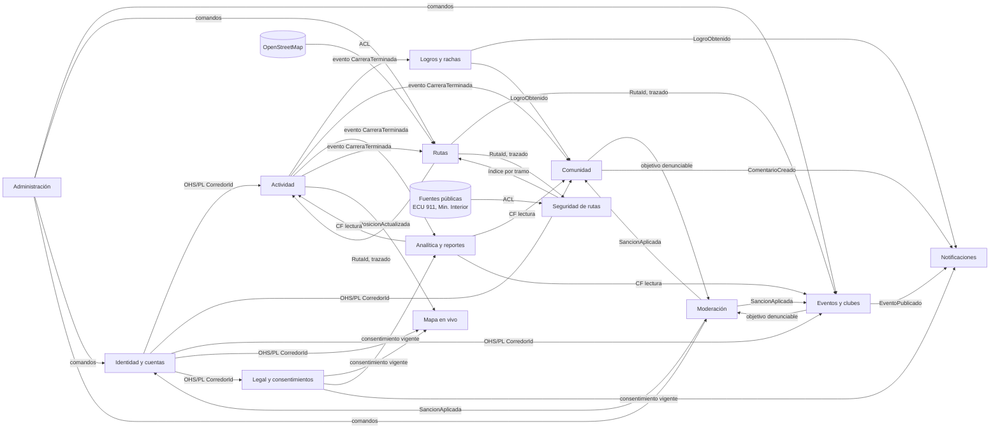
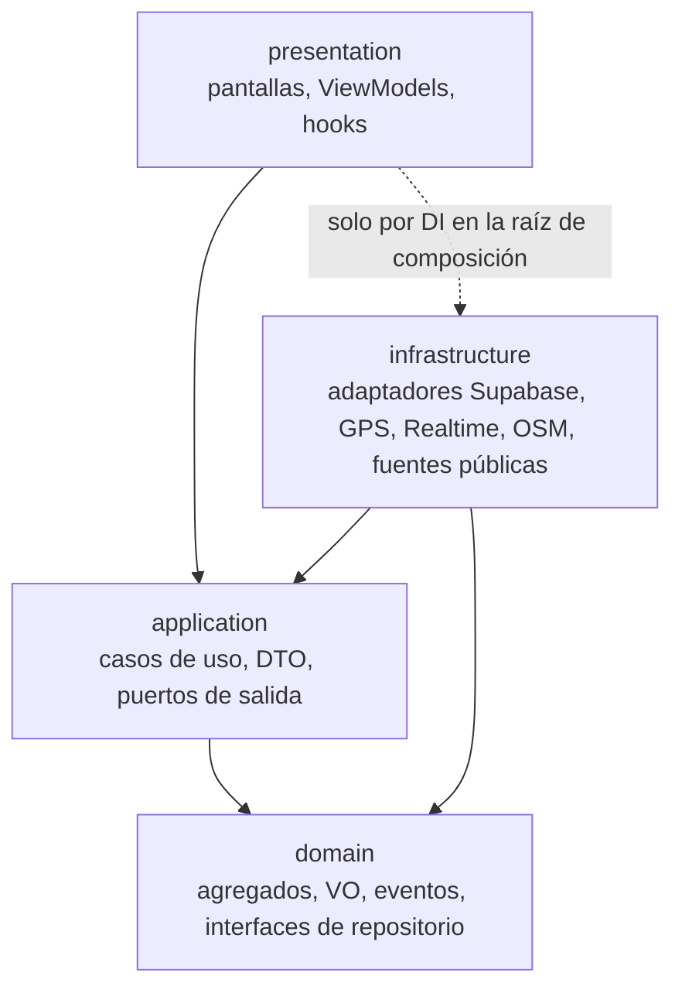
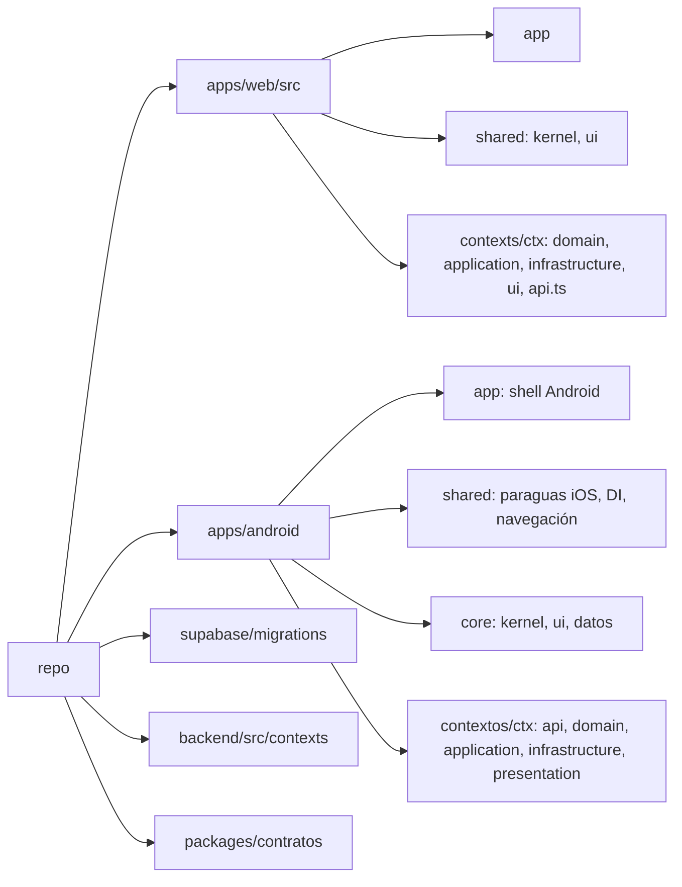
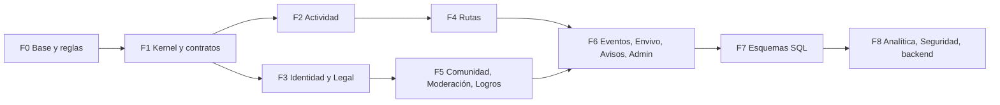

# Arquitectura DDD de Gacelas

Diseño aprobado ([ADR 004](adr/004-arquitectura-ddd.md)). Fases F0, F1, F2, F3, F4, F5 y F6 aplicadas. Basada en `main` del 25 de octubre de 2026, después de fusionar los PR #79, #80 y #81. Amplía el [ADR 003](adr/003-arquitectura-modular.md) y reemplaza la sección "Bounded contexts" de [ARQUITECTURA.md](ARQUITECTURA.md) cuando se apruebe.

## Estado de la migración

| Fase | Estado | Notas                                                                                                                                                                                                                                                                                                                                                                                                                                                                                                                                                                    |
| ---- | ------ | ------------------------------------------------------------------------------------------------------------------------------------------------------------------------------------------------------------------------------------------------------------------------------------------------------------------------------------------------------------------------------------------------------------------------------------------------------------------------------------------------------------------------------------------------------------------------ |
| F0   | Hecha  | ADR 004; avisos de ESLint y dependency-cruiser en web; tarea `verificarArquitectura` en Gradle. Konsist queda para cuando haya módulo `:arquitectura-test`                                                                                                                                                                                                                                                                                                                                                                                                               |
| F1   | Hecha  | `src/shared/kernel` y `com.gacelas.kernel` (en `core:comun`); `packages/contratos`; renombres D1 en web (`src/contexts/{actividad,identidad,legal,seguridad}`) y Android (módulos y paquetes)                                                                                                                                                                                                                                                                                                                                                                            |
| F2   | Hecha  | Pruebas de caracterización del flujo de carrera (Kotlin y web); módulo `:contextos:actividad:application` con los casos de uso; web con puertos `FuenteUbicacion` y `BloqueoPantalla`, adaptadores de GPS del navegador y Supabase en `contexts/actividad/infrastructure`. Los servicios de Android con APIs de plataforma (`LocationService`, avisos, pantallas de `app/correr`) siguen en `app` como adaptadores de plataforma                                                                                                                                         |
| F3   | Hecha  | Legal con `domain` (textos y reglas de consentimiento), `infrastructure` (historial local y Supabase), `ui` y `api.ts` publicada; Identidad con `api.ts` e `infrastructure/authSupabase.ts`; `store/app.ts` ya no importa Supabase (la composición de repositorios pasa a `data/composicion.ts`). En Android, Identidad y Legal ya estaban separados desde F1                                                                                                                                                                                                            |
| F4   | Hecha  | Web: pantallas en `contexts/rutas/ui`, reglas de rutas y elevación en `domain`, repositorios Supabase de rutas y exploración en `infrastructure/rutasSupabase.ts`, y `api.ts` como fachada; `usuario` y `traducirError` pasan a `shared/supabase`. En Android, el catálogo oficial de Loja y la importación OSM ya estaban en `contextos:rutas`; las pantallas de `app/rutas` siguen en `app` porque usan MapLibre y APIs de Android                                                                                                                                     |
| F5   | Hecha  | Web: contexto `logros` (reglas en `domain`, registro local y Supabase en `infrastructure`, `api.ts`); feed, publicaciones, corredores y social en `contexts/comunidad/ui` con su repositorio Supabase en `infrastructure`; rachas de Supabase en `actividad/infrastructure`. `data/tipos.ts`, rachas, estadísticas y la configuración de intervalos pasan a `shared/kernel` porque los usan Actividad, Analítica y Logros. La publicación automática al terminar una carrera y las denuncias generalizadas quedan para cuando se pidan, porque cambian el comportamiento |
| F6   | Hecha  | Contextos En vivo, Avisos y Administracion con su API publicada; el panel recibe Moderacion y Analitica por composicion en su capa de UI; la carpeta features desaparece y la pantalla de inicio pasa a app/inicio.. Cierre de F6 en web: `src/lib`, `src/components`, `src/data` y `src/store` desaparecen; cada contexto tiene su store en `application` publicado por `api.ts`, `app/estado.ts` coordina la carga y los efectos entre contextos, el tipo `legacy` se elimina y las reglas de ESLint y dependency-cruiser pasan a error                                |

## 1. Diagnóstico del estado actual

### 1.1 Lo que ya existe

El ADR 003 dejó una base modular parcial:

- Android/KMP: módulos Gradle `core:comun`, `core:datos`, `core:ui` y `contextos:<ctx>:domain|data|presentation` para cuatro contextos (`carreras`, `rutas`, `cuenta`, `comunidad`), más el módulo paraguas `:shared` con DI y navegación. Convenciones en `build-logic`.
- Web: `src/features/<ctx>` con capas `domain`, `application`, `ui` solo en `carreras`; `eslint-plugin-boundaries` con tipos `app`, `shared`, `domain`, `data`, `application`, `ui` y un tipo `legacy` que puede importar cualquier cosa.
- Supabase: 21 migraciones numeradas en `supabase/migrations`, todas en el esquema `public`; seeds en `backend/seeds`; pruebas RLS en `backend/tests/rls`.

### 1.2 Problemas detectados

| Área     | Problema                                                                                                                                                                                                                                                      | Impacto                                                                  |
| -------- | ------------------------------------------------------------------------------------------------------------------------------------------------------------------------------------------------------------------------------------------------------------- | ------------------------------------------------------------------------ |
| Web      | Llamadas directas a Supabase (`from`, `rpc`, `channel`, `storage`) repartidas en `data/supabaseRepos.ts` (unas 60), `features/admin/api.ts` (20), `lib/clubes.ts` (15), `features/carreras/domain/enVivo.ts` (9), `features/comunidad/domain/mapaVivo.ts` (5) | El dominio depende de la infraestructura; no se puede probar sin red     |
| Web      | `src/lib` plano con lógica de negocio (`rachas.ts`, `estadisticas.ts`, `intervalos.ts`, `logica.ts`, `rutas.ts`, `eventos.ts`) mezclada con utilidades técnicas, y duplicados con `src/shared/lib` (`geo`, `mapas`, `validacion`, `webgl`)                    | No hay un único lugar para cada regla                                    |
| Web      | `src/store/app.ts` monolítico (Zustand) que mezcla sesión, datos de varios contextos y acceso a Supabase                                                                                                                                                      | Acoplamiento entre contextos a través del estado global                  |
| Web      | `features/comunidad` agrupa feed, clubes, eventos, mapa vivo y en vivo; `features/social` y `features/legal` sin capas                                                                                                                                        | Contextos distintos comparten carpeta y crecen juntos                    |
| Web      | Regla `legacy` con `allow: ['*']` y carpetas fuera de los tipos (`lib`, `store`, `data`, `components`)                                                                                                                                                        | La mayor parte del código no está cubierta por las reglas de dependencia |
| Android  | `app/src/main` todavía tiene pantallas y lógica (`correr`, `rutas`, `perfil`, `ajustes`, `comunidad`, `vivo`, `envivo`, `legal`, `tracking`)                                                                                                                  | La lógica no se comparte con iOS                                         |
| KMP      | `:shared` contiene lógica de contextos que aún no tienen módulo (`vivo/MapaVivo.kt` usa Supabase directo, `legal`, `social`, `acceso`, `inicio`)                                                                                                              | El paraguas se convierte en otro monolito                                |
| KMP      | `core:datos` concentra el cliente remoto y los repositorios de todos los contextos                                                                                                                                                                            | Cada cambio de datos recompila todo                                      |
| KMP      | Paquetes inconsistentes (`com.gacelas.tracking` dentro de `contextos/carreras/domain`)                                                                                                                                                                        | Difícil verificar fronteras por paquete                                  |
| Supabase | 38 tablas en `public` sin agrupación; RPC y políticas RLS de varios contextos en la misma migración (por ejemplo `020_admin_reportes_logros.sql`)                                                                                                             | Sin propiedad clara de cada tabla                                        |
| CI       | `db.yml` ejecuta `psql -f` sin `ON_ERROR_STOP`                                                                                                                                                                                                                | Una migración rota puede pasar en verde                                  |

## 2. Bounded contexts

Se proponen trece contextos agrupados en tres niveles de importancia.

| Tipo     | Contexto                | Código       | Responsabilidad                                                       |
| -------- | ----------------------- | ------------ | --------------------------------------------------------------------- |
| Núcleo   | Actividad               | `actividad`  | Carreras, seguimiento GPS, métricas, intervalos, historial            |
| Núcleo   | Rutas                   | `rutas`      | Catálogo, rutas oficiales de Loja, trazado, reseñas, guía, offline    |
| Núcleo   | Mapa en vivo            | `envivo`     | Posición compartida en tiempo real y seguimiento de carreras en vivo  |
| Núcleo   | Seguridad de rutas      | `seguridad`  | Incidentes de fuentes públicas e índice de seguridad por tramo y hora |
| Soporte  | Comunidad               | `comunidad`  | Publicaciones, comentarios, reacciones, seguidores                    |
| Soporte  | Eventos y clubes        | `eventos`    | Clubes, membresías, eventos, inscripciones, recordatorios             |
| Soporte  | Logros y rachas         | `logros`     | Rachas, insignias, metas                                              |
| Soporte  | Moderación              | `moderacion` | Denuncias de contenido, usuarios, comentarios y eventos; sanciones    |
| Soporte  | Analítica y reportes    | `analitica`  | Estadísticas del admin y resúmenes personales del corredor            |
| Soporte  | Administración          | `admin`      | Roles, gestión de usuarios, publicación de eventos y rutas oficiales  |
| Genérico | Identidad y cuentas     | `identidad`  | Autenticación, perfil, ajustes, privacidad                            |
| Genérico | Legal y consentimientos | `legal`      | Versiones de términos, aceptaciones y consentimientos revocables      |
| Genérico | Notificaciones          | `avisos`     | Bandeja, push, correos, preferencias                                  |

### 2.1 Lenguaje ubicuo

| Contexto   | Término              | Definición                                                                                    |
| ---------- | -------------------- | --------------------------------------------------------------------------------------------- |
| identidad  | Corredor             | Persona con cuenta. Se identifica por `CorredorId` (igual al id de Supabase Auth)             |
| identidad  | Perfil               | Datos públicos del corredor: alias, foto, ciudad, nivel de privacidad                         |
| identidad  | Zona de hogar        | Área privada alrededor de la casa que se oculta en trazados públicos                          |
| legal      | Documento legal      | Términos, privacidad o política de ubicación, con versión y fecha de vigencia                 |
| legal      | Aceptación           | Registro de que un corredor aceptó una versión concreta                                       |
| legal      | Consentimiento       | Permiso revocable para un uso específico (ubicación en vivo, analítica, correos)              |
| actividad  | Carrera              | Sesión de actividad desde Empezar hasta Terminar                                              |
| actividad  | Punto de traza       | Muestra GPS con latitud, longitud, altitud, precisión y hora                                  |
| actividad  | Traza                | Secuencia ordenada de puntos de traza de una carrera                                          |
| actividad  | Ritmo                | Minutos por kilómetro                                                                         |
| actividad  | Parcial              | Tramo de un kilómetro dentro de una carrera                                                   |
| actividad  | Plan de intervalos   | Serie de bloques de trabajo y descanso                                                        |
| rutas      | Ruta                 | Trazado reutilizable con distancia, desnivel, superficie y dificultad                         |
| rutas      | Ruta oficial         | Ruta curada por Gacelas (senderos, montañas, parques y vías urbanas de Loja)                  |
| rutas      | Tipo de terreno      | Sendero, montaña, parque, urbana                                                              |
| rutas      | Reseña               | Calificación y comentario de un corredor sobre una ruta                                       |
| envivo     | Posición compartida  | Última ubicación que un corredor hizo visible a otros                                         |
| envivo     | Visibilidad          | Quién puede ver la posición: nadie, seguidores, todos                                         |
| envivo     | Sesión en vivo       | Carrera que se transmite a seguidores mediante enlace                                         |
| seguridad  | Incidente            | Hecho reportado por una fuente pública con lugar, categoría y hora aproximada                 |
| seguridad  | Fuente               | Origen de los datos (ECU 911, Ministerio del Interior, Fiscalía, ANT) con su licencia         |
| seguridad  | Franja horaria       | Bloque de horas en que se agregan incidentes (por ejemplo 05:00 a 07:00)                      |
| seguridad  | Índice de seguridad  | Valor por tramo de ruta y franja horaria calculado a partir de incidentes                     |
| comunidad  | Publicación          | Entrada del feed, normalmente asociada a una carrera, con texto y fotos                       |
| comunidad  | Comentario, Reacción | Respuesta o "me gusta" sobre una publicación                                                  |
| comunidad  | Seguimiento          | Relación dirigida entre dos corredores                                                        |
| eventos    | Club                 | Grupo de corredores con administradores                                                       |
| eventos    | Evento               | Carrera o quedada con fecha, lugar y cupo; pasa por borrador, publicado, cancelado, terminado |
| eventos    | Inscripción          | Confirmación de asistencia de un corredor a un evento                                         |
| logros     | Racha                | Días consecutivos con al menos una carrera válida                                             |
| logros     | Logro                | Insignia otorgada al cumplir una regla                                                        |
| moderacion | Denuncia             | Reporte de un usuario sobre contenido o persona                                               |
| moderacion | Caso                 | Agrupación de denuncias sobre el mismo objetivo, con estado y resolución                      |
| moderacion | Sanción              | Ocultar contenido, advertencia, suspensión                                                    |
| analitica  | Resumen personal     | Totales del corredor por semana, mes o año                                                    |
| analitica  | Indicador            | Métrica agregada del sistema (usuarios activos, carreras por día)                             |
| admin      | Rol                  | Permiso de un usuario: corredor, moderador, administrador                                     |
| avisos     | Aviso                | Notificación dirigida a un corredor por un canal                                              |

### 2.2 Mapa de contextos

Relaciones: `U` es proveedor (upstream), `D` es consumidor (downstream). OHS es servicio abierto, PL lenguaje publicado, ACL capa anticorrupción, CF conformista.



Reglas del mapa:

- Ningún contexto lee tablas de otro. Se comunican por identificadores, interfaces publicadas en `api` o eventos de dominio.
- Analítica es conformista: lee vistas de solo lectura publicadas por los demás contextos, nunca sus tablas internas.
- Seguridad y Rutas consumen datos externos solo a través de una capa anticorrupción que traduce el formato de la fuente al lenguaje del contexto.
- Administración no tiene modelo propio de negocio salvo roles; orquesta casos de uso de otros contextos.

## 3. Modelo por contexto

Notación: agregados en negrita, entidades (E), value objects (VO), eventos de dominio en pasado, repositorios como interfaces del dominio, casos de uso en la capa de aplicación.

### 3.1 Identidad y cuentas (`identidad`)

- Agregados: **Corredor** (raíz) con Perfil (E), AjustesCorredor (E).
- Value objects: CorredorId, Alias, CorreoElectronico, NivelPrivacidad, ZonaHogar, Unidades.
- Eventos: CorredorRegistrado, PerfilActualizado, PrivacidadCambiada, CuentaEliminada.
- Repositorios: `CorredorRepositorio`, `SesionAutenticacion` (puerto hacia Supabase Auth).
- Casos de uso: IniciarSesion, Registrarse, CerrarSesion, ActualizarPerfil, CambiarPrivacidad, DefinirZonaHogar, EliminarCuenta.
- Tablas: `profiles`, `user_settings`.

### 3.2 Legal y consentimientos (`legal`)

- Agregados: **DocumentoLegal** (versiones inmutables), **RegistroConsentimientos** por corredor con Aceptacion (E) y Consentimiento (E).
- Value objects: VersionDocumento, TipoDocumento, PropositoConsentimiento, EstadoConsentimiento.
- Eventos: TerminosAceptados, ConsentimientoOtorgado, ConsentimientoRevocado, NuevaVersionPublicada.
- Repositorios: `DocumentoLegalRepositorio`, `ConsentimientoRepositorio`.
- Casos de uso: ConsultarDocumentoVigente, AceptarTerminos, OtorgarConsentimiento, RevocarConsentimiento, VerificarConsentimiento (API publicada para otros contextos).
- Tablas: `legal_versions`, `consents`.

### 3.3 Actividad (`actividad`)

- Agregados: **Carrera** (raíz) con Traza (E), Parcial (E); **PlanIntervalos**.
- Value objects: CarreraId, PuntoTraza, Distancia, Duracion, Ritmo, Desnivel, EstadoCarrera (preparada, en curso, en pausa, terminada, descartada), TipoActividad.
- Invariantes: no se agregan puntos a una carrera terminada; los puntos dentro de la zona de hogar se marcan como privados; una carrera con distancia menor al mínimo no cuenta para logros.
- Eventos: CarreraIniciada, CarreraPausada, CarreraReanudada, CarreraTerminada, CarreraDescartada, ParcialCompletado.
- Repositorios: `CarreraRepositorio`, `TrazaRepositorio` (envío por lotes), `FuenteUbicacion` (puerto GPS de plataforma).
- Casos de uso: EmpezarCarrera, RegistrarPunto, PausarCarrera, TerminarCarrera, SincronizarPendientes, ConsultarHistorial, SeguirPlanIntervalos.
- Tablas: `activities`, `activity_tracks`, `track_points`, `track_batches`, `activity_summaries`.

### 3.4 Rutas (`rutas`)

- Agregados: **Ruta** (raíz) con Reseña (E), FotoRuta (E); **RutaGuardada** por corredor.
- Value objects: RutaId, Trazado, TipoTerreno, Dificultad, Superficie, OrigenRuta (oficial, comunidad), Calificacion.
- Eventos: RutaCreada, RutaOficialPublicada, RutaResenada, RutaCorrida.
- Repositorios: `RutaRepositorio`, `ResenaRepositorio`, `CatalogoTrazadosExterno` (ACL hacia OpenStreetMap), `MapaOffline`.
- Casos de uso: ExplorarRutas, VerDetalle, DibujarRuta, GuardarRuta, ResenarRuta, GuiarPorRuta, DescargarOffline, ImportarRutasOficiales.
- Tablas: `routes`, `route_reviews`, `route_likes`, `route_photos`, `route_runs`, `saved_routes`.

### 3.5 Mapa en vivo (`envivo`)

- Agregados: **PosicionCompartida** por corredor; **SesionEnVivo** con espectadores.
- Value objects: Visibilidad, Coordenada aproximada (redondeo para proteger privacidad), Caducidad.
- Invariantes: solo se publica si existe consentimiento de ubicación vigente y la visibilidad no es "nadie"; nunca dentro de la zona de hogar; la posición caduca a los pocos minutos sin actualización.
- Eventos: PosicionPublicada, PosicionRetirada, SesionEnVivoIniciada, SesionEnVivoTerminada.
- Repositorios: `PosicionRepositorio`, `CanalTiempoReal` (puerto hacia Supabase Realtime).
- Casos de uso: PublicarPosicion, VerCorredoresCercanos, CompartirCarreraEnVivo, DejarDeCompartir.
- Tablas: `runner_positions`, `live_sessions`, `live_private`, `live_sharing_settings`.

### 3.6 Seguridad de rutas (`seguridad`)

- Agregados: **Incidente** (inmutable, importado); **IndiceSeguridad** por tramo de ruta y franja horaria.
- Value objects: FuenteDatos, CategoriaIncidente, ZonaGeografica (celda o polígono), FranjaHoraria, NivelRiesgo (bajo, medio, alto, sin datos).
- Invariantes: cada incidente guarda fuente, licencia y fecha de importación; un índice sin datos suficientes se muestra como "sin datos", nunca como seguro.
- Eventos: IncidentesImportados, IndiceRecalculado.
- Repositorios: `IncidenteRepositorio`, `FuenteIncidentes` (ACL por fuente pública), `IndiceRepositorio`.
- Casos de uso: ImportarIncidentes (proceso programado), RecalcularIndice, ConsultarSeguridadDeRuta(rutaId, hora), SugerirHorarioSeguro.
- Tablas nuevas: `seguridad.incidentes`, `seguridad.indices`. Depende de qué datos públicos existan con lugar y hora; queda sujeto a la investigación en curso.

### 3.7 Comunidad (`comunidad`)

- Agregados: **Publicacion** (raíz) con Comentario (E), Imagen (E), Reaccion (VO); **Seguimiento**.
- Value objects: PublicacionId, TextoPublicacion, Visibilidad, ResumenCarrera (copia de lectura de Actividad).
- Eventos: PublicacionCreada, ComentarioCreado, PublicacionReaccionada, CorredorSeguido, PublicacionOcultada.
- Repositorios: `PublicacionRepositorio`, `SeguimientoRepositorio`, `AlmacenImagenes`.
- Casos de uso: VerFeed, PublicarCarrera, Comentar, Reaccionar, Compartir, Seguir, DejarDeSeguir.
- Tablas: `post_images`, `post_likes`, `post_comments`, `post_reposts`, `follows` (las publicaciones hoy se derivan de `activities`; ver decisión D4).

### 3.8 Eventos y clubes (`eventos`)

- Agregados: **Club** con Membresia (E); **Evento** con Inscripcion (E), Recordatorio (E).
- Value objects: EstadoEvento, Cupo, LugarEvento, RolEnClub.
- Invariantes: no se inscribe por encima del cupo; solo eventos publicados son visibles; un evento terminado no acepta inscripciones.
- Eventos: ClubCreado, CorredorUnidoAClub, EventoPublicado, EventoCancelado, InscripcionConfirmada.
- Repositorios: `ClubRepositorio`, `EventoRepositorio`.
- Casos de uso: CrearClub, UnirseAClub, CrearEvento, PublicarEvento, Inscribirse, ProgramarRecordatorio, VerCalendario.
- Tablas: `clubs`, `club_members`, `club_posts`, `events`, `event_rsvps`, `event_reminders`.

### 3.9 Logros y rachas (`logros`)

- Agregados: **Racha** por corredor; **ColeccionLogros** por corredor.
- Value objects: ReglaLogro, TipoLogro, DiasConsecutivos.
- Eventos: RachaExtendida, RachaPerdida, LogroObtenido.
- Repositorios: `RachaRepositorio`, `LogroRepositorio`.
- Casos de uso: EvaluarCarrera (reacciona a CarreraTerminada), ConsultarLogros, ConsultarRacha.
- Tablas: `user_streaks`, `user_achievements`.

### 3.10 Moderación (`moderacion`)

- Agregados: **Caso** con Denuncia (E) y Resolucion (E).
- Value objects: ObjetivoDenuncia (tipo y id: publicación, comentario, usuario, evento), MotivoDenuncia, EstadoCaso, Sancion.
- Eventos: DenunciaRecibida, CasoResuelto, SancionAplicada.
- Repositorios: `CasoRepositorio`.
- Casos de uso: Denunciar, ListarCasosPendientes, ResolverCaso, AplicarSancion.
- Tablas: `post_reports` (se generaliza a cualquier objetivo).

### 3.11 Analítica y reportes (`analitica`)

- Modelo de lectura (sin agregados transaccionales): ResumenPersonal, Indicador, SerieTemporal.
- Value objects: Periodo, Granularidad, FormatoExportacion.
- Repositorios: `ConsultaAnalitica` (vistas materializadas o RPC de solo lectura).
- Casos de uso: VerResumenPersonal, VerPanelAdmin, ExportarReporte.
- Respeta el consentimiento de analítica de Legal.

### 3.12 Notificaciones (`avisos`)

- Agregados: **Aviso**; **PreferenciasAvisos** por corredor.
- Value objects: Canal (bandeja, push, correo), TipoAviso.
- Eventos: AvisoEnviado, AvisoLeido.
- Repositorios: `AvisoRepositorio`, `EmisorPush`, `EmisorCorreo`.
- Casos de uso: Notificar (reacciona a eventos de otros contextos), MarcarLeido, CambiarPreferencias.
- Tablas: `notifications`.

### 3.13 Administración (`admin`)

- Agregados: **AsignacionRol**.
- Value objects: Rol, Permiso.
- Eventos: RolAsignado, RolRevocado.
- Repositorios: `RolRepositorio`.
- Casos de uso: AsignarRol, BuscarUsuarios, SuspenderUsuario (delega en Moderación e Identidad), PublicarEvento (delega en Eventos), PublicarRutaOficial (delega en Rutas).
- Tablas: `user_roles`, `app_settings`, `app_releases`.

## 4. Capas



| Capa           | Contiene                                                             | Puede depender de                  | Prohibido                                  |
| -------------- | -------------------------------------------------------------------- | ---------------------------------- | ------------------------------------------ |
| domain         | Agregados, entidades, VO, eventos, reglas, interfaces de repositorio | `kernel` compartido                | Supabase, React, Compose, Android, red, DI |
| application    | Casos de uso, puertos, DTO, bus de eventos                           | domain propio, `api` de otros      | Supabase, UI                               |
| infrastructure | Implementaciones de repositorios, mapeo de filas, clientes externos  | domain y application propios       | presentation                               |
| presentation   | Pantallas, ViewModels, componentes                                   | application propio, `kernel` de UI | infrastructure (salvo la raíz de DI)       |

Cada contexto expone un módulo `api` pequeño (identificadores, DTO publicados, interfaces de consulta y eventos) que es lo único que otros contextos pueden importar.

### 4.1 Móvil (KMP)

- El dominio y la aplicación de cada contexto viven en `commonMain` y se comparten con iOS.
- Infraestructura en `commonMain` cuando usa supabase-kt; en `androidMain`/`iosMain` para GPS, notificaciones y sensores.
- `apps/android/app` queda como shell: `MainActivity`, servicios en primer plano, permisos y DI de plataforma. Sus pantallas se mueven a `presentation` de cada contexto.
- `:shared` queda solo como paraguas que exporta el framework iOS, la navegación y la DI.

### 4.2 Web

- `src/contexts/<ctx>/{domain,application,infrastructure,ui}` más `api.ts` como fachada pública.
- `src/app` es la raíz de composición: router, proveedores y creación de adaptadores.
- `src/shared/kernel` para tipos base (Id, Resultado, coordenadas); `src/shared/ui` para el sistema de diseño C2.
- Supabase solo se importa desde `infrastructure`. Cada contexto tiene su store pequeño en `ui` o `application`; `store/app.ts` desaparece.
- Los tipos de dominio se escriben a mano; los tipos generados de Supabase (`tipos.gen.ts`) solo se usan en `infrastructure` para mapear filas.

### 4.3 Compartir tipos entre web y móvil

Opción recomendada: mantener los modelos en cada lenguaje y compartir un contrato, el esquema SQL y los tipos generados. Se agrega `packages/contratos` con esquemas JSON de eventos y DTO publicados, desde los que se generan tipos TypeScript y se validan los de Kotlin en pruebas. Exportar el dominio KMP a JavaScript (Kotlin/JS) se descarta por ahora por peso del bundle y fricción con React (decisión D2).

### 4.4 Supabase como infraestructura

- Esquemas PostgreSQL por contexto: `identidad`, `legal`, `actividad`, `rutas`, `envivo`, `seguridad`, `comunidad`, `eventos`, `logros`, `moderacion`, `analitica`, `avisos`, `admin`.
- Migración por etapas sin romper clientes: se crea el esquema, se mueve la tabla y se deja en `public` una vista con el nombre antiguo hasta que ningún cliente la use.
- Las RPC se nombran `<contexto>.<accion>` y son la interfaz preferida para operaciones con invariantes (por ejemplo `eventos.inscribirse` comprueba el cupo en la base).
- Eventos de dominio entre contextos: tabla `kernel.eventos_salida` (outbox) llenada por triggers o RPC y consumida por Edge Functions o el backend propio.
- RLS por contexto en el archivo de su migración; pruebas en `backend/tests/rls/<ctx>`.
- Migraciones nuevas con prefijo de contexto en el nombre: `022_eventos_cupos.sql`.

### 4.5 Backend propio por dominios

Para cuando Supabase no alcance (procesos programados, importación de incidentes, analítica pesada, correos):

- `backend/` como servicio TypeScript (Node 20, pnpm) con la misma estructura `src/contexts/<ctx>/{domain,application,infrastructure,http}`.
- Primeros módulos: `seguridad` (importador de fuentes públicas e índice), `analitica` (agregados y exportación), `avisos` (consumidor del outbox, push y correo).
- Comparte `packages/contratos` con la web.
- Despliegue y proveedor quedan para un ADR aparte (decisión D6).

## 5. Estructura de carpetas objetivo



```text
apps/
  web/src/
    app/                      raíz de composición, router, DI
    shared/kernel/            Id, Resultado, Coordenada, errores
    shared/ui/                componentes C2
    contexts/
      actividad/
        domain/
        application/
        infrastructure/       supabase, geolocalización del navegador
        ui/
        api.ts
      rutas/ ...
  android/
    app/                      shell Android
    shared/                   paraguas KMP para iOS
    core/kernel/ core/ui/ core/datos/ (solo cliente Supabase y sincronización)
    contextos/
      actividad/{api,domain,application,infrastructure,presentation}/
      rutas/ ...
  ios/iosApp/                 shell SwiftUI
packages/contratos/           esquemas JSON de eventos y DTO
supabase/migrations/          NNN_<contexto>_<tema>.sql
backend/src/contexts/<ctx>/   servicios propios
backend/tests/rls/<ctx>/
```

Nombres: los módulos actuales `carreras` y `cuenta` pasan a `actividad` e `identidad`; `data` pasa a `infrastructure` y se añade `application` (decisión D1).

## 6. Reglas de dependencia verificables

### 6.1 Web

- `eslint-plugin-boundaries` (ya instalado) con tipos por contexto y capa: `{ type: 'domain', pattern: 'src/contexts/*/domain/**', capture: ['ctx'] }` y equivalentes.
- Reglas: `domain` solo importa `domain` del mismo contexto y `shared/kernel`; `application` importa su `domain` y `api.ts` de otros contextos; `infrastructure` importa su `domain` y `application`; `ui` importa su `application`, `domain` y `shared/ui`; entre contextos solo `api.ts`.
- `no-restricted-imports` para `@supabase/supabase-js` fuera de `infrastructure` y `src/shared/supabase`.
- El tipo `legacy` se mantiene durante la migración con una lista explícita de carpetas que se reduce en cada fase; la meta es eliminarlo.
- `dependency-cruiser` en CI para detectar ciclos y generar el grafo (`pnpm --filter @gacelas/web arch`), como complemento a ESLint.

### 6.2 Android y KMP

- Un módulo Gradle por contexto y capa: `:contextos:<ctx>:api|domain|application|infrastructure|presentation`.
- Plugins de convención en `build-logic` (`gacelas.kmp.domain`, `gacelas.kmp.infra`, etc.) que fijan qué dependencias puede declarar cada tipo de módulo; el de domain no admite supabase-kt, Ktor ni Compose.
- Tarea `verificarArquitectura` en `build-logic` que falla si un módulo de un contexto depende de un módulo que no sea `api` de otro contexto.
- Pruebas de arquitectura con Konsist en un módulo `:arquitectura-test` (JVM): paquetes `com.gacelas.<ctx>.<capa>`, sin imports de `io.github.jan.supabase` en domain y application, ViewModels solo en presentation, casos de uso con sufijo y método `invoke`.

### 6.3 Base de datos

- Prueba SQL en `backend/tests/rls` que verifica que cada tabla está en el esquema de su contexto y tiene RLS activada.
- `ON_ERROR_STOP=1` en `db.yml` (pendiente, requiere permiso `workflow` o que lo aplique Jhona).

## 7. Plan de migración incremental

Requisito: PR #82 y `feat/rutas-loja-reportes` fusionados en `main`. Cada fase es uno o más PR pequeños con CI en verde; las funciones existentes siguen funcionando en todo momento. Estimaciones en días de trabajo efectivo.



| Fase | Contenido                                                                                                                                                                                                                                                                                                                                                                                                                                                        | Riesgo                                                       | Estimación |
| ---- | ---------------------------------------------------------------------------------------------------------------------------------------------------------------------------------------------------------------------------------------------------------------------------------------------------------------------------------------------------------------------------------------------------------------------------------------------------------------- | ------------------------------------------------------------ | ---------- |
| F0   | Aprobar este documento como ADR 004. Activar reglas de boundaries y Konsist en modo aviso; tarea `verificarArquitectura`; inventario `legacy`                                                                                                                                                                                                                                                                                                                    | Bajo: no mueve código                                        | 2 días     |
| F1   | `shared/kernel` web y `core:kernel` KMP; `packages/contratos`; bus de eventos de dominio en memoria; renombrar `data` a `infrastructure` y crear `application` en los cuatro contextos actuales                                                                                                                                                                                                                                                                  | Bajo-medio: renombres masivos, conflictos con ramas abiertas | 3 días     |
| F2   | Actividad: mover pantallas de `app/correr` y `tracking` a `contextos/actividad`; casos de uso Empezar/Terminar; web `contexts/actividad` con adaptador Supabase y GPS                                                                                                                                                                                                                                                                                            | Alto: es el flujo principal y usa servicios en primer plano  | 5 días     |
| F3   | Identidad y Legal: separar `cuenta` en `identidad` y `legal`; consentimientos como API publicada; quitar Supabase de `store/app.ts` para sesión                                                                                                                                                                                                                                                                                                                  | Medio: autenticación y aceptación obligatoria                | 3 días     |
| F4   | Rutas: incluir rutas oficiales de Loja e importador OSM como ACL; mover `app/rutas`; web `contexts/rutas`                                                                                                                                                                                                                                                                                                                                                        | Medio                                                        | 3 días     |
| F5   | Comunidad, Moderación y Logros: dividir `features/comunidad` y `features/social`; publicación reacciona a CarreraTerminada; denuncias generalizadas                                                                                                                                                                                                                                                                                                              | Medio: el feed tiene mucho estado                            | 5 días     |
| F6   | Eventos y clubes, Mapa en vivo, Notificaciones y Administración: sacar `vivo/MapaVivo.kt` de `:shared`; `features/admin/api.ts` se divide en adaptadores por contexto                                                                                                                                                                                                                                                                                            | Medio-alto: Realtime y permisos de admin                     | 5 días     |
| F7   | Esquemas SQL por contexto con vistas de compatibilidad; RPC con prefijo de contexto; pruebas RLS por contexto; quitar vistas cuando las versiones viejas de la app dejen de usarse. Estado: bloqueada, a la espera de acceso a Supabase y de un respaldo                                                                                                                                                                                                         | Alto: datos en producción; necesita respaldo y ventana       | 4 días     |
| F8   | Analítica sobre vistas de lectura; Seguridad de rutas con importador e índice (según los datos públicos disponibles); backend propio para procesos programados y outbox. Estado: hecha en el código. Android y KMP con `application`, `infrastructure` y `presentation` en Analítica y Seguridad; backend TypeScript por contextos con casos de uso y adaptadores sobre Supabase, con pruebas y sin desplegar. El outbox y los procesos programados esperan a F7 | Medio: depende de fuentes externas y del proveedor           | 6 días     |

Total aproximado: 36 días de trabajo. Al final de F6 el tipo `legacy` de ESLint debe estar vacío y las reglas pasan de aviso a error. Las funciones nuevas que se pidan durante la migración se construyen ya en la estructura nueva.

Criterio de terminado por fase: CI en verde, reglas de arquitectura sin nuevas violaciones, pruebas de dominio para los agregados movidos, capturas sin cambios visuales en Android y web.

## 8. Decisiones que necesitan aprobación

| Id  | Decisión                                                                                                                                       | Propuesta                                                                |
| --- | ---------------------------------------------------------------------------------------------------------------------------------------------- | ------------------------------------------------------------------------ |
| D1  | Renombrar contextos existentes (`carreras` a `actividad`, `cuenta` a `identidad` y `legal`) y `data` a `infrastructure`                        | Sí, en F1, para que el lenguaje ubicuo sea el mismo en todo el código    |
| D2  | Cómo compartir tipos entre web y móvil                                                                                                         | Contratos JSON en `packages/contratos`; no usar Kotlin/JS por ahora      |
| D3  | Esquemas PostgreSQL por contexto                                                                                                               | Sí, en F7, con vistas de compatibilidad y respaldo previo                |
| D4  | Publicación como entidad propia del feed (tabla `comunidad.publicaciones`) en vez de derivarla de `activities`                                 | Sí, permite publicaciones sin carrera y desacopla Comunidad de Actividad |
| D5  | Herramientas de verificación: eslint-plugin-boundaries más dependency-cruiser en web, Konsist en KMP                                           | Sí                                                                       |
| D6  | Backend propio: momento, lenguaje y proveedor de despliegue                                                                                    | TypeScript en F8, proveedor en un ADR aparte                             |
| D7  | Seguridad de rutas: alcance según la disponibilidad real de datos del ECU 911 y otras fuentes, con aviso legal de que el índice es orientativo | Confirmar tras la investigación de fuentes                               |
| D8  | Congelar funciones grandes durante F2 y F7, que tocan el flujo de carrera y la base de datos                                                   | Sí, una semana cada una                                                  |
