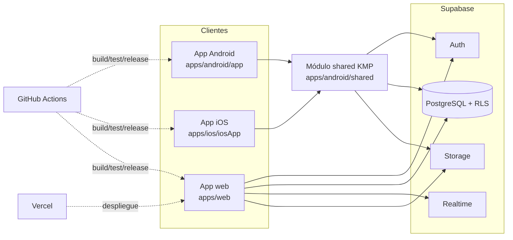
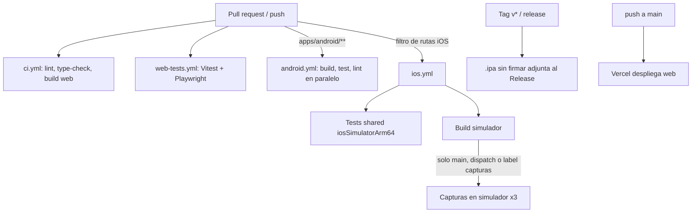

# Arquitectura de Gacelas

Documento de referencia de la arquitectura actual y objetivo. Basado en el código de `main` (commit ee9902e, 13 de octubre de 2026). Detalle por parte:

- App móvil (shared KMP, Android, iOS): [arquitectura/movil.md](arquitectura/movil.md)
- App web (`apps/web`): [arquitectura/web.md](arquitectura/web.md)
- Backend Supabase y CI/CD: secciones de este documento

Propuesta de evolución DDD: [ARQUITECTURA-DDD.md](ARQUITECTURA-DDD.md).

Documentos relacionados: `SYSTEM.md` (visión funcional inicial), `DATA_MODEL.md`, `SUPABASE.md`, `SECURITY_PRIVACY.md`, `adr/001-backend-selection.md`. Costos de operación: [PRESUPUESTO.md](PRESUPUESTO.md).

## Visión general

| Parte                   | Ubicación                                                | Tecnología                                   | Estilo actual                                               | Estilo objetivo                                                                        |
| ----------------------- | -------------------------------------------------------- | -------------------------------------------- | ----------------------------------------------------------- | -------------------------------------------------------------------------------------- |
| Lógica móvil compartida | `apps/android/shared` + modulos `core/*` y `contextos/*` | Kotlin Multiplatform + Compose Multiplatform | Modulos Gradle por capa y bounded context                   | Clean Architecture + MVVM, DDD ligero (ver [ADR 003](adr/003-arquitectura-modular.md)) |
| Android                 | `apps/android/app`                                       | Kotlin, Jetpack Compose                      | Shell de plataforma con pantallas propias                   | Shell fino: piezas de plataforma para `ContenedorApp`, servicios Android, navegación   |
| iOS                     | `apps/ios/iosApp`                                        | SwiftUI + framework `shared`                 | Wrapper SwiftUI; pantallas Compose MP de `shared`           | Igual; solo integración nativa                                                         |
| Web                     | `apps/web`                                               | React 18, Vite, TypeScript, Zustand          | `src/app`, `src/shared`, features con domain/application/ui | Feature-based con capas y ESLint boundaries                                            |
| Backend                 | `supabase/migrations`                                    | Supabase (Postgres, RLS, Storage, Realtime)  | Migraciones SQL numeradas                                   | Igual + tests de RLS y tipos generados                                                 |

## Bounded contexts

Los mismos cuatro contextos organizan móvil, web y base de datos.

| Contexto    | Responsabilidad                                            | Tablas principales                                                                                                          |
| ----------- | ---------------------------------------------------------- | --------------------------------------------------------------------------------------------------------------------------- |
| `actividad` | Sesión de carrera, tracking, estadísticas, rachas, en vivo | `activities`, `activity_tracks`, `track_points`, `user_streaks`, `live_sessions`, `live_private`, `live_sharing_settings`   |
| `rutas`     | Catálogo, exploración, guía, reseñas, offline              | `routes`, `route_reviews`, `route_likes`, `route_photos`, `route_runs`, `saved_routes`                                      |
| `identidad` | Autenticación, perfil, ajustes, privacidad, notificaciones | `profiles`, `user_settings`, `notifications`                                                                                |
| `comunidad` | Seguidores, feed, clubes, eventos                          | `follows`, `post_likes`, `post_comments`, `clubs`, `club_members`, `club_posts`, `events`, `event_rsvps`, `event_reminders` |

Reglas entre contextos:

- Un contexto no importa `data` ni `presentation` de otro. Si necesita algo, depende de un modelo o puerto (interfaz) del `domain` del otro, o se usa un identificador (`carreraId`, `rutaId`).
- `shared` (utilidades puras: fechas, geo, uuid, plataforma) puede usarse desde cualquier capa; no puede depender de ningún contexto.

## Clima de Inicio (contexto `clima`)

El chip de clima de Inicio (C2, mismo diseño) muestra datos reales de Open-Meteo (`https://api.open-meteo.com/v1/forecast`, `current=temperature_2m,weather_code,is_day`), gratis y sin clave. Atribución CC BY 4.0: "Datos del clima: Open-Meteo.com" en Ajustes > Acerca de (Android, iOS y web).

- Móvil (KMP): `contextos/clima/domain` (modelo `ClimaActual`, puertos `FuenteClima`, `CacheClima`, `ClimaRepositorio` y `ReglasClima`: códigos WMO a español, refresco de 15 min, etiqueta de lugar, coordenadas a 2 decimales) y `contextos/clima/infrastructure` (`OpenMeteoFuenteClima` sobre `Red` de Ktor, `CacheClimaDataStore`, `ClimaRepositorioOpenMeteo`). `ContenedorApp.clima` y `ClimaInicioViewModel` (shared, Inicio).
- Web: `src/contexts/clima` (mismas reglas en `domain/clima.ts`, `fetch` directo con cache en `localStorage` y el hook `useClima`).
- Reglas: se muestra la cache al instante; se llama a la red al abrir Inicio como mucho cada 15 min (también tras un fallo), con timeout de 5 s. Sin cache ni red el chip dice "LOJA --"; nunca un valor inventado.
- Ubicación: solo la última ubicación conocida y solo si el permiso de ubicación (el de carreras) ya está concedido; no se pide permiso nuevo ni se rastrea. Sin permiso o si falla, Loja (-3.9931, -79.2042). En la web se usa `navigator.permissions` para no abrir el aviso del navegador.
- Etiqueta del lugar: "Loja" con el respaldo o a menos de 30 km de Loja. Más lejos, Android usa el `Geocoder` del sistema (ciudad) y, si no hay o falla, "Tu zona". La web no tiene geocodificación inversa barata: "Tu zona".
- iOS: Inicio es compartido y usa el mismo repositorio, pero la ubicación para el clima aún no se lee (requiere código nativo de CoreLocation fuera de la carrera): siempre Loja.
- Privacidad: la ubicación no va a ningún servidor propio; a Open-Meteo solo van coordenadas redondeadas a 2 decimales (unos 1 km).

## Backend Supabase

### Estado actual

- Migraciones SQL numeradas en `backend/migrations` (`001_initial_schema.sql` a `014_...`), aplicadas en orden. No hay carpeta `supabase/` de la CLI.
- RLS activado en las tablas de usuario; las políticas están en la misma migración que crea la tabla (unas 75 `create policy`).
- Lógica en base de datos: RPC para en vivo (`008_live_rpc.sql`), rachas (`006`), privacidad (`004`, `005`).
- Storage: buckets `route-photos` (010), `share-images` (011) y `app-releases` (013), con políticas propias.
- Seeds de datos de ejemplo en las migraciones `003` y `014`.

### Convenciones

- Archivo nuevo por cambio: `NNN_descripcion_snake.sql`. Nunca editar una migración ya aplicada.
- Tablas en inglés, `snake_case` plural; columnas `snake_case`; `id uuid` y `created_at timestamptz`.
- Cada tabla nueva incluye en la misma migración: `enable row level security`, políticas explícitas por operación (`select`/`insert`/`update`/`delete`) y los índices de las FK.
- Las políticas usan `auth.uid()`. La visibilidad pública pasa por la configuración de privacidad (`profiles`, `live_sharing_settings`), nunca por políticas `using (true)` sobre datos personales.
- Buckets: nombre `kebab-case`, rutas `<user_id>/<archivo>`, política de escritura que compruebe `(storage.foldername(name))[1] = auth.uid()::text`.
- La clave `service_role` nunca va en los clientes ni en el repositorio; los clientes usan solo la `anon key`.

### Objetivo y pendientes

- Pendiente: separar seeds de esquema (`backend/seeds/`) para no cargar datos de ejemplo en producción.
- Pendiente: tests de RLS (pgTAP o script con dos usuarios) ejecutados en CI contra Postgres local.
- Pendiente: generar tipos TypeScript desde el esquema (`supabase gen types`) para `apps/web/src/data/tipos.ts`.
- Pendiente: decidir si se adopta la estructura `supabase/` de la CLI (migraciones con timestamp) en un ADR.

## CI/CD y releases

### Estado actual

- Cuatro workflows: `ci.yml` (build, formato, lint de código y de documentación, tests; jobs en paralelo), `web-tests.yml`, `android.yml` (matriz build/test/lint en paralelo, APK debug como artefacto) e `ios.yml`.
- Filtros de rutas: cada workflow corre solo si cambian sus carpetas (en `ios.yml`, job `cambios` con `dorny/paths-filter`).
- `ios.yml`: `Tests shared (iosSimulatorArm64)` y `Build simulador` corren en paralelo en `macos-15`. Cachés: Gradle (`setup-gradle`), una sola entrada `~/.konan` compartida, SPM, framework compartido (`shared/build` + `.gradle`) y DerivedData de Xcode. En CI solo se compila el target `iosSimulatorArm64`.
- Capturas del simulador (matriz de 3 grupos + `Unir capturas`): solo en push a `main`, `workflow_dispatch` o PR con label `capturas`. Otros labels no lanzan ni cancelan runs.
- Tiempos medidos en PR: iOS 4-6.5 min (antes 13-24 min), Android unos 1.5 min, CI web menos de 1 min.
- Releases: un tag `v*` o un Release publicado genera `.ipa` sin firmar y `.app` de simulador y los adjunta al Release (job `ipa`). El bucket `app-releases` (migración 013) sirve los binarios y el aviso de actualización en la app (`data/actualizacion`).
- Web: despliegue en Vercel (`apps/web/vercel.json`), con previews por PR.

### Objetivo y pendientes

- Pendiente: APK release firmada y adjunta al mismo Release `v*` (hoy solo hay APK debug).
- Hecho: pantallas de comunidad (#67, #68), dibujar ruta (#69) y corredor 3D de Inicio (#70) compartidos con iOS, con capturas de paridad.
- Pendiente: configurar login en iOS (Sign in with Apple / sesión de Supabase en el build).
- Pendiente: firma iOS y subida a TestFlight (secrets `IOS_CERT_P12`, `IOS_PROFILE`, `ASC_API_KEY` ya previstos en el workflow).
- Pendiente: workflow de migraciones (validar SQL en Postgres efímero en PR; aplicar en producción solo manualmente o con aprobación).
- Pendiente: chequeo automático de reglas de dependencias (ver móvil y web).
- Convención: versión semántica `vMAYOR.MENOR.PARCHE`; la misma versión en Android (`versionName`), iOS (`CFBundleShortVersionString`) y los metadatos publicados en `app-releases`. Android deriva `versionCode` de `versionName`.

## Dónde va cada cosa (resumen)

| Quiero añadir                                         | Lugar                                                                                   |
| ----------------------------------------------------- | --------------------------------------------------------------------------------------- |
| Regla de negocio (cálculo, validación)                | `shared/.../<contexto>/domain/reglas` y su equivalente web `features/<contexto>/domain` |
| Caso de uso                                           | `shared/.../<contexto>/domain/casosuso`                                                 |
| Acceso a Supabase o almacenamiento local              | `shared/.../<contexto>/data` (implementa un repositorio de `domain/repositorio`)        |
| Estado de pantalla                                    | `shared/.../<contexto>/presentation` (ViewModel)                                        |
| Pantalla Compose común                                | `shared/.../<contexto>/presentation/ui`                                                 |
| API de plataforma (sensores, GPS, mapas)              | `expect` en `commonMain`, `actual` en `androidMain` / `iosMain`                         |
| Servicio Android (foreground service, notificaciones) | `apps/android/app`                                                                      |
| Integración nativa iOS (MapLibre, Sign in with Apple) | `apps/ios/iosApp`                                                                       |
| Tabla, política o bucket                              | nueva migración en `backend/migrations`                                                 |
| Job de CI                                             | workflow de la app afectada, con filtro de rutas                                        |
