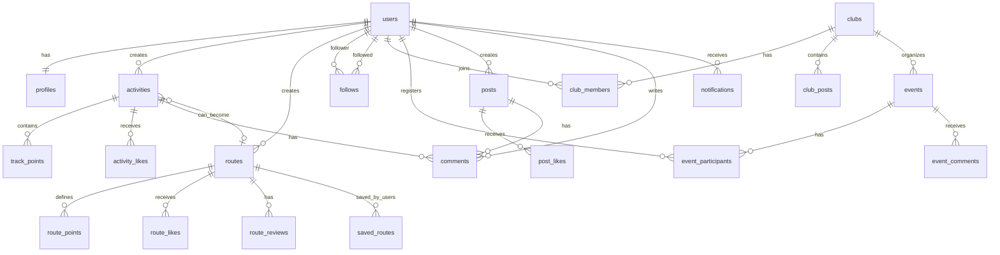

# Modelo de Datos - Gacelas

## Diagrama Entidad-Relación



## Entidades Detalladas

### 1. `users` (Gestionada por Supabase Auth)

```sql
CREATE TABLE auth.users (
    id UUID PRIMARY KEY DEFAULT uuid_generate_v4(),
    email TEXT UNIQUE NOT NULL,
    encrypted_password TEXT,
    email_confirmed_at TIMESTAMP WITH TIME ZONE,
    created_at TIMESTAMP WITH TIME ZONE DEFAULT NOW(),
    updated_at TIMESTAMP WITH TIME ZONE DEFAULT NOW()
);
```

**Descripción**: Usuario base del sistema, gestionado por Supabase Auth.

**Índices**:

- `PRIMARY KEY (id)`
- `UNIQUE (email)`

---

### 2. `profiles`

```sql
CREATE TABLE profiles (
    id UUID PRIMARY KEY REFERENCES auth.users(id) ON DELETE CASCADE,
    username TEXT UNIQUE NOT NULL,
    full_name TEXT,
    avatar_url TEXT,
    bio TEXT,
    location TEXT,
    date_of_birth DATE,
    gender TEXT CHECK (gender IN ('male', 'female', 'other', 'prefer_not_to_say')),
    privacy_level TEXT DEFAULT 'public' CHECK (privacy_level IN ('public', 'followers', 'private')),
    home_location GEOGRAPHY(Point, 4326),  -- Para home zone fuzzing
    home_radius_meters INTEGER DEFAULT 300,
    measurement_unit TEXT DEFAULT 'metric' CHECK (measurement_unit IN ('metric', 'imperial')),
    created_at TIMESTAMP WITH TIME ZONE DEFAULT NOW(),
    updated_at TIMESTAMP WITH TIME ZONE DEFAULT NOW()
);

CREATE INDEX profiles_username_idx ON profiles(username);
CREATE INDEX profiles_location_idx ON profiles USING GIST(home_location);
```

**Descripción**: Perfil público/privado del usuario con configuraciones de privacidad.

**Campos importantes**:

- `home_location`: Ubicación de casa para ocultar inicio/fin de rutas
- `privacy_level`: Controla quién puede ver actividades

**Relaciones**:

- 1:1 con `users`

---

### 3. `activities`

```sql
CREATE TABLE activities (
    id UUID PRIMARY KEY DEFAULT uuid_generate_v4(),
    user_id UUID NOT NULL REFERENCES auth.users(id) ON DELETE CASCADE,
    title TEXT NOT NULL,
    description TEXT,
    activity_type TEXT DEFAULT 'run' CHECK (activity_type IN ('run', 'walk', 'hike', 'bike', 'other')),

    -- Timestamps
    start_time TIMESTAMP WITH TIME ZONE NOT NULL,
    end_time TIMESTAMP WITH TIME ZONE,

    -- Métricas calculadas
    distance_meters INTEGER,
    duration_seconds INTEGER,
    avg_pace_seconds_per_km INTEGER,
    avg_speed_mps FLOAT,
    max_speed_mps FLOAT,
    elevation_gain_meters INTEGER,
    elevation_loss_meters INTEGER,
    calories INTEGER,

    -- Ubicaciones (con fuzzing)
    started_location GEOGRAPHY(Point, 4326),
    ended_location GEOGRAPHY(Point, 4326),

    -- Metadata
    is_public BOOLEAN DEFAULT false,
    is_live_shared BOOLEAN DEFAULT false,  -- Está compartiendo en vivo actualmente
    route_id UUID REFERENCES routes(id) ON DELETE SET NULL,  -- Si se guardó como ruta

    -- Stats sociales (desnormalizado para performance)
    likes_count INTEGER DEFAULT 0,
    comments_count INTEGER DEFAULT 0,

    created_at TIMESTAMP WITH TIME ZONE DEFAULT NOW(),
    updated_at TIMESTAMP WITH TIME ZONE DEFAULT NOW()
);

CREATE INDEX activities_user_id_idx ON activities(user_id);
CREATE INDEX activities_start_time_idx ON activities(start_time DESC);
CREATE INDEX activities_is_public_idx ON activities(is_public) WHERE is_public = true;
CREATE INDEX activities_started_location_idx ON activities USING GIST(started_location);
```

**Descripción**: Actividad individual grabada por un usuario.

**Métricas**:

- `distance_meters`: Distancia total en metros
- `duration_seconds`: Duración en segundos
- `avg_pace_seconds_per_km`: Ritmo promedio (seg/km)
- `elevation_gain_meters`: Ascenso acumulado

**Relaciones**:

- N:1 con `users`
- 1:N con `track_points`
- N:1 opcional con `routes` (si se guardó como ruta)

---

### 4. `track_points`

```sql
CREATE TABLE track_points (
    id UUID PRIMARY KEY DEFAULT uuid_generate_v4(),
    activity_id UUID NOT NULL REFERENCES activities(id) ON DELETE CASCADE,

    location GEOGRAPHY(Point, 4326) NOT NULL,  -- PostGIS: (lon, lat)
    elevation_meters FLOAT,
    timestamp TIMESTAMP WITH TIME ZONE NOT NULL,
    accuracy_meters FLOAT,
    speed_mps FLOAT,  -- m/s
    bearing_degrees FLOAT,  -- 0-360

    created_at TIMESTAMP WITH TIME ZONE DEFAULT NOW()
);

CREATE INDEX track_points_activity_id_idx ON track_points(activity_id);
CREATE INDEX track_points_timestamp_idx ON track_points(timestamp);
CREATE INDEX track_points_location_idx ON track_points USING GIST(location);
```

**Descripción**: Puntos GPS individuales que forman la ruta de una actividad.

**Frecuencia**: 1 punto cada 3-5 segundos durante la actividad.

**Volumen estimado**:

- 1 hora de running = ~1,200 puntos
- Tamaño por punto: ~50 bytes
- 1 actividad = ~60 KB

**Relaciones**:

- N:1 con `activities`

**Optimización**:

- Índice GIST para consultas espaciales rápidas
- Particionado por `activity_id` si el volumen crece mucho

---

### 5. `routes`

```sql
CREATE TABLE routes (
    id UUID PRIMARY KEY DEFAULT uuid_generate_v4(),
    user_id UUID NOT NULL REFERENCES auth.users(id) ON DELETE CASCADE,

    name TEXT NOT NULL,
    description TEXT,

    -- Métricas
    distance_meters INTEGER NOT NULL,
    elevation_gain_meters INTEGER,
    difficulty TEXT CHECK (difficulty IN ('easy', 'moderate', 'hard', 'extreme')),
    route_type TEXT CHECK (route_type IN ('loop', 'out_and_back', 'point_to_point')),
    surface TEXT CHECK (surface IN ('road', 'trail', 'mixed', 'track')),

    -- Geoespacial
    start_location GEOGRAPHY(Point, 4326) NOT NULL,
    end_location GEOGRAPHY(Point, 4326),
    bounding_box GEOGRAPHY(Polygon, 4326),  -- Para búsquedas rápidas

    -- Metadata
    is_public BOOLEAN DEFAULT true,
    is_verified BOOLEAN DEFAULT false,  -- Verificada por moderadores
    tags TEXT[],  -- ['scenic', 'flat', 'urban', etc.]

    -- Stats (desnormalizadas)
    likes_count INTEGER DEFAULT 0,
    times_completed INTEGER DEFAULT 0,
    avg_rating FLOAT,

    -- Origen
    created_from_activity_id UUID REFERENCES activities(id) ON DELETE SET NULL,

    created_at TIMESTAMP WITH TIME ZONE DEFAULT NOW(),
    updated_at TIMESTAMP WITH TIME ZONE DEFAULT NOW()
);

CREATE INDEX routes_user_id_idx ON routes(user_id);
CREATE INDEX routes_is_public_idx ON routes(is_public) WHERE is_public = true;
CREATE INDEX routes_start_location_idx ON routes USING GIST(start_location);
CREATE INDEX routes_bounding_box_idx ON routes USING GIST(bounding_box);
CREATE INDEX routes_difficulty_idx ON routes(difficulty);
CREATE INDEX routes_tags_idx ON routes USING GIN(tags);
```

**Descripción**: Ruta guardada y compartible, creada desde una actividad o dibujada manualmente.

**Relaciones**:

- N:1 con `users`
- 1:N con `route_points`
- 1:N con `route_reviews`

---

### 6. `route_points`

```sql
CREATE TABLE route_points (
    id UUID PRIMARY KEY DEFAULT uuid_generate_v4(),
    route_id UUID NOT NULL REFERENCES routes(id) ON DELETE CASCADE,

    location GEOGRAPHY(Point, 4326) NOT NULL,
    sequence INTEGER NOT NULL,  -- Orden de los puntos (1, 2, 3...)
    elevation_meters FLOAT,

    -- Puntos de interés opcionales
    poi_type TEXT,  -- 'water_fountain', 'rest_area', 'scenic_view', 'parking'
    poi_description TEXT,

    created_at TIMESTAMP WITH TIME ZONE DEFAULT NOW(),

    UNIQUE(route_id, sequence)
);

CREATE INDEX route_points_route_id_idx ON route_points(route_id, sequence);
CREATE INDEX route_points_location_idx ON route_points USING GIST(location);
```

**Descripción**: Puntos que definen el trazado de una ruta. Similar a `track_points` pero más simplificado.

**Optimización**:

- Algoritmo Douglas-Peucker para reducir número de puntos sin perder forma

---

### 7. `follows`

```sql
CREATE TABLE follows (
    id UUID PRIMARY KEY DEFAULT uuid_generate_v4(),
    follower_id UUID NOT NULL REFERENCES auth.users(id) ON DELETE CASCADE,
    followed_id UUID NOT NULL REFERENCES auth.users(id) ON DELETE CASCADE,

    status TEXT DEFAULT 'pending' CHECK (status IN ('pending', 'accepted', 'rejected')),

    created_at TIMESTAMP WITH TIME ZONE DEFAULT NOW(),
    updated_at TIMESTAMP WITH TIME ZONE DEFAULT NOW(),

    UNIQUE(follower_id, followed_id),
    CHECK(follower_id != followed_id)  -- No te puedes seguir a ti mismo
);

CREATE INDEX follows_follower_id_idx ON follows(follower_id);
CREATE INDEX follows_followed_id_idx ON follows(followed_id);
CREATE INDEX follows_status_idx ON follows(status);
```

**Descripción**: Relación de seguimiento entre usuarios.

**Estados**:

- `pending`: Solicitud enviada pero no aceptada (para cuentas privadas)
- `accepted`: Seguimiento activo
- `rejected`: Solicitud rechazada

**Relaciones**:

- N:1 con `users` (follower)
- N:1 con `users` (followed)

---

### 8. `clubs`

```sql
CREATE TABLE clubs (
    id UUID PRIMARY KEY DEFAULT uuid_generate_v4(),
    name TEXT NOT NULL,
    slug TEXT UNIQUE NOT NULL,  -- Para URLs amigables
    description TEXT,

    location TEXT,  -- Ciudad o región
    location_point GEOGRAPHY(Point, 4326),

    avatar_url TEXT,
    cover_url TEXT,

    is_public BOOLEAN DEFAULT true,  -- Cualquiera puede unirse o requiere invitación

    -- Stats
    members_count INTEGER DEFAULT 0,

    created_by UUID NOT NULL REFERENCES auth.users(id) ON DELETE SET NULL,
    created_at TIMESTAMP WITH TIME ZONE DEFAULT NOW(),
    updated_at TIMESTAMP WITH TIME ZONE DEFAULT NOW()
);

CREATE INDEX clubs_slug_idx ON clubs(slug);
CREATE INDEX clubs_is_public_idx ON clubs(is_public) WHERE is_public = true;
CREATE INDEX clubs_location_point_idx ON clubs USING GIST(location_point);
```

**Descripción**: Club o grupo de runners.

---

### 9. `club_members`

```sql
CREATE TABLE club_members (
    id UUID PRIMARY KEY DEFAULT uuid_generate_v4(),
    club_id UUID NOT NULL REFERENCES clubs(id) ON DELETE CASCADE,
    user_id UUID NOT NULL REFERENCES auth.users(id) ON DELETE CASCADE,

    role TEXT DEFAULT 'member' CHECK (role IN ('owner', 'admin', 'member')),
    joined_at TIMESTAMP WITH TIME ZONE DEFAULT NOW(),

    UNIQUE(club_id, user_id)
);

CREATE INDEX club_members_club_id_idx ON club_members(club_id);
CREATE INDEX club_members_user_id_idx ON club_members(user_id);
```

**Descripción**: Membresía de usuarios en clubes.

---

### 10. `events`

```sql
CREATE TABLE events (
    id UUID PRIMARY KEY DEFAULT uuid_generate_v4(),
    club_id UUID REFERENCES clubs(id) ON DELETE CASCADE,  -- Puede ser null para eventos independientes

    title TEXT NOT NULL,
    description TEXT,
    event_type TEXT CHECK (event_type IN ('group_run', 'race', 'training', 'social')),

    start_time TIMESTAMP WITH TIME ZONE NOT NULL,
    duration_minutes INTEGER,

    meeting_point GEOGRAPHY(Point, 4326) NOT NULL,
    meeting_address TEXT,

    planned_distance_meters INTEGER,
    planned_route_id UUID REFERENCES routes(id) ON DELETE SET NULL,

    max_participants INTEGER,  -- Null = ilimitado
    is_public BOOLEAN DEFAULT true,

    -- Stats
    participants_count INTEGER DEFAULT 0,

    created_by UUID NOT NULL REFERENCES auth.users(id) ON DELETE SET NULL,
    created_at TIMESTAMP WITH TIME ZONE DEFAULT NOW(),
    updated_at TIMESTAMP WITH TIME ZONE DEFAULT NOW()
);

CREATE INDEX events_start_time_idx ON events(start_time DESC);
CREATE INDEX events_club_id_idx ON events(club_id);
CREATE INDEX events_meeting_point_idx ON events USING GIST(meeting_point);
CREATE INDEX events_is_public_idx ON events(is_public) WHERE is_public = true;
```

**Descripción**: Evento de running (carrera grupal, entrenamiento, competencia).

---

### 11. `event_participants`

```sql
CREATE TABLE event_participants (
    id UUID PRIMARY KEY DEFAULT uuid_generate_v4(),
    event_id UUID NOT NULL REFERENCES events(id) ON DELETE CASCADE,
    user_id UUID NOT NULL REFERENCES auth.users(id) ON DELETE CASCADE,

    status TEXT DEFAULT 'registered' CHECK (status IN ('registered', 'confirmed', 'cancelled', 'attended')),
    activity_id UUID REFERENCES activities(id) ON DELETE SET NULL,  -- Su actividad durante el evento

    registered_at TIMESTAMP WITH TIME ZONE DEFAULT NOW(),

    UNIQUE(event_id, user_id)
);

CREATE INDEX event_participants_event_id_idx ON event_participants(event_id);
CREATE INDEX event_participants_user_id_idx ON event_participants(user_id);
```

---

### 12. `posts`

```sql
CREATE TABLE posts (
    id UUID PRIMARY KEY DEFAULT uuid_generate_v4(),
    user_id UUID NOT NULL REFERENCES auth.users(id) ON DELETE CASCADE,
    club_id UUID REFERENCES clubs(id) ON DELETE CASCADE,  -- Null = post personal

    content TEXT NOT NULL,
    image_urls TEXT[],

    -- Referencia a actividad compartida
    shared_activity_id UUID REFERENCES activities(id) ON DELETE SET NULL,

    -- Stats
    likes_count INTEGER DEFAULT 0,
    comments_count INTEGER DEFAULT 0,

    created_at TIMESTAMP WITH TIME ZONE DEFAULT NOW(),
    updated_at TIMESTAMP WITH TIME ZONE DEFAULT NOW()
);

CREATE INDEX posts_user_id_idx ON posts(user_id);
CREATE INDEX posts_club_id_idx ON posts(club_id);
CREATE INDEX posts_created_at_idx ON posts(created_at DESC);
```

**Descripción**: Post en el feed social (puede incluir una actividad compartida).

---

### 13. `comments`

```sql
CREATE TABLE comments (
    id UUID PRIMARY KEY DEFAULT uuid_generate_v4(),
    user_id UUID NOT NULL REFERENCES auth.users(id) ON DELETE CASCADE,

    -- Polimórfico: puede comentar en actividad, ruta, post, evento
    commentable_type TEXT NOT NULL CHECK (commentable_type IN ('activity', 'route', 'post', 'event')),
    commentable_id UUID NOT NULL,

    content TEXT NOT NULL,

    -- Para hilos de comentarios
    parent_comment_id UUID REFERENCES comments(id) ON DELETE CASCADE,

    created_at TIMESTAMP WITH TIME ZONE DEFAULT NOW(),
    updated_at TIMESTAMP WITH TIME ZONE DEFAULT NOW()
);

CREATE INDEX comments_user_id_idx ON comments(user_id);
CREATE INDEX comments_commentable_idx ON comments(commentable_type, commentable_id);
CREATE INDEX comments_parent_comment_id_idx ON comments(parent_comment_id);
```

**Descripción**: Comentarios en actividades, rutas, posts o eventos.

---

### 14. `notifications`

```sql
CREATE TABLE notifications (
    id UUID PRIMARY KEY DEFAULT uuid_generate_v4(),
    user_id UUID NOT NULL REFERENCES auth.users(id) ON DELETE CASCADE,

    type TEXT NOT NULL CHECK (type IN (
        'follow_request',
        'follow_accepted',
        'activity_like',
        'activity_comment',
        'event_invite',
        'club_invite',
        'live_tracking_started'
    )),

    title TEXT NOT NULL,
    body TEXT,

    -- Referencia genérica al objeto relacionado
    related_entity_type TEXT,
    related_entity_id UUID,

    is_read BOOLEAN DEFAULT false,

    created_at TIMESTAMP WITH TIME ZONE DEFAULT NOW()
);

CREATE INDEX notifications_user_id_idx ON notifications(user_id);
CREATE INDEX notifications_is_read_idx ON notifications(is_read) WHERE is_read = false;
CREATE INDEX notifications_created_at_idx ON notifications(created_at DESC);
```

---

### 15. `activity_likes`, `route_likes`, `post_likes`

```sql
-- Tabla genérica para likes
CREATE TABLE activity_likes (
    id UUID PRIMARY KEY DEFAULT uuid_generate_v4(),
    activity_id UUID NOT NULL REFERENCES activities(id) ON DELETE CASCADE,
    user_id UUID NOT NULL REFERENCES auth.users(id) ON DELETE CASCADE,
    created_at TIMESTAMP WITH TIME ZONE DEFAULT NOW(),
    UNIQUE(activity_id, user_id)
);

CREATE TABLE route_likes (
    id UUID PRIMARY KEY DEFAULT uuid_generate_v4(),
    route_id UUID NOT NULL REFERENCES routes(id) ON DELETE CASCADE,
    user_id UUID NOT NULL REFERENCES auth.users(id) ON DELETE CASCADE,
    created_at TIMESTAMP WITH TIME ZONE DEFAULT NOW(),
    UNIQUE(route_id, user_id)
);

CREATE TABLE post_likes (
    id UUID PRIMARY KEY DEFAULT uuid_generate_v4(),
    post_id UUID NOT NULL REFERENCES posts(id) ON DELETE CASCADE,
    user_id UUID NOT NULL REFERENCES auth.users(id) ON DELETE CASCADE,
    created_at TIMESTAMP WITH TIME ZONE DEFAULT NOW(),
    UNIQUE(post_id, user_id)
);
```

---

### 16. `saved_routes`

```sql
CREATE TABLE saved_routes (
    id UUID PRIMARY KEY DEFAULT uuid_generate_v4(),
    user_id UUID NOT NULL REFERENCES auth.users(id) ON DELETE CASCADE,
    route_id UUID NOT NULL REFERENCES routes(id) ON DELETE CASCADE,

    notes TEXT,  -- Notas personales sobre la ruta

    created_at TIMESTAMP WITH TIME ZONE DEFAULT NOW(),

    UNIQUE(user_id, route_id)
);

CREATE INDEX saved_routes_user_id_idx ON saved_routes(user_id);
```

**Descripción**: Rutas guardadas por un usuario para correr más tarde.

---

## Queries Comunes

### 1. Feed de Actividades de Seguidos

```sql
SELECT
    a.*,
    p.username,
    p.avatar_url,
    (SELECT COUNT(*) FROM activity_likes WHERE activity_id = a.id) as likes_count,
    (SELECT COUNT(*) FROM comments WHERE commentable_type = 'activity' AND commentable_id = a.id) as comments_count
FROM activities a
JOIN profiles p ON a.user_id = p.id
WHERE
    a.is_public = true
    AND a.user_id IN (
        SELECT followed_id
        FROM follows
        WHERE follower_id = :current_user_id
        AND status = 'accepted'
    )
ORDER BY a.start_time DESC
LIMIT 20;
```

### 2. Rutas Cerca de Mi Ubicación

```sql
SELECT
    r.*,
    p.username as creator_name,
    ST_Distance(
        r.start_location,
        ST_SetSRID(ST_MakePoint(:my_lon, :my_lat), 4326)::geography
    ) as distance_meters
FROM routes r
JOIN profiles p ON r.user_id = p.id
WHERE
    r.is_public = true
    AND ST_DWithin(
        r.start_location,
        ST_SetSRID(ST_MakePoint(:my_lon, :my_lat), 4326)::geography,
        10000  -- 10 km
    )
ORDER BY distance_meters ASC
LIMIT 20;
```

### 3. Estadísticas de Usuario

```sql
SELECT
    COUNT(*) as total_activities,
    SUM(distance_meters) as total_distance_meters,
    SUM(duration_seconds) as total_duration_seconds,
    SUM(elevation_gain_meters) as total_elevation_meters,
    AVG(avg_pace_seconds_per_km) as avg_pace
FROM activities
WHERE
    user_id = :user_id
    AND start_time >= NOW() - INTERVAL '1 year';
```

## Migraciones

Las migraciones se encuentran en `supabase/migrations/` y se ejecutan en orden numérico:

1. `001_initial_schema.sql`: Tablas base, PostGIS, indices y RLS

Las migraciones siguientes se agregan en el mismo directorio, en orden numerico. No se aplican contra el proyecto free desde CI.

## Próximos Pasos

Ver [SYSTEM.md](SYSTEM.md) para implementación de la arquitectura de datos.
