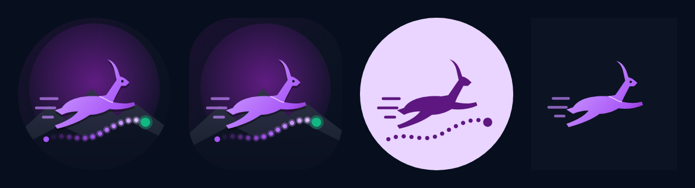
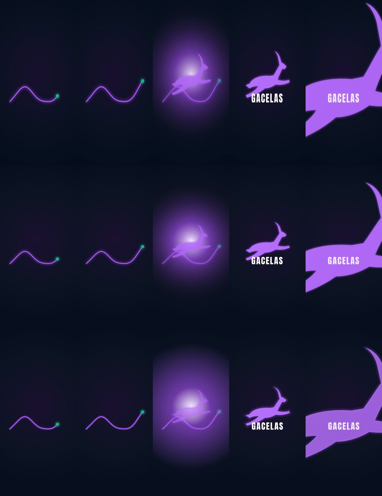

# Marca: icono e intro animada

Elegidos por Jhona el 26 de octubre de 2026: icono propuesta A "Gacela en ruta" e intro A "Ruta y destello" (estilo Netflix, 2,8 s).

## Paleta y tipografia

| Uso                                         | Color                 |
| ------------------------------------------- | --------------------- |
| Morado principal                            | `#7B1FA2`             |
| Morado brillante (ruta, brillo)             | `#A855F7`             |
| Morado claro                                | `#C084FC`             |
| Lila                                        | `#E9D5FF` y `#F3E8FF` |
| Fondo de marca (splash, intro, theme-color) | `#0C1322`             |
| Fondo profundo                              | `#070E1D`             |
| Acento GPS                                  | `#10B981`             |

Titulares en Anton (la palabra GACELAS de la intro) y textos en Archivo. Ver tambien docs/PALETA.md.

## Icono

Fuentes en `assets/marca/`: `icono.svg` (completo), `fondo.svg` y `primer_plano.svg` (capas del icono adaptativo, lienzo 108 x 108 con zona segura de 66).

- Fondo: degradado violeta a azul noche, halo morado y montanas de Loja.
- Primer plano: gacela en salto con estelas de velocidad sobre una ruta GPS punteada que termina en un punto verde.
- Monocromo (iconos tematicos de Android 13): gacela, estelas y ruta en una sola tinta.



### Archivos generados

| Plataforma | Archivo                                                                                                                |
| ---------- | ---------------------------------------------------------------------------------------------------------------------- |
| Android    | `res/drawable/ic_launcher_background.xml`, `ic_launcher_foreground.xml`, `ic_launcher_monochrome.xml` (VectorDrawable) |
| Android    | `res/mipmap-anydpi-v26/ic_launcher.xml` y `ic_launcher_round.xml` (adaptativo)                                         |
| Android    | `res/mipmap-{mdpi..xxxhdpi}/ic_launcher.png` y `ic_launcher_round.png` (Android 7)                                     |
| Android    | `res/drawable/splash_icono.xml` (icono del SplashScreen)                                                               |
| Play Store | `assets/marca/play_store_512.png`                                                                                      |
| Web        | `public/favicon.svg`, `favicon.ico`, `favicon-32.png`, `apple-touch-icon.png`                                          |
| Web (PWA)  | `public/icon-192.png`, `icon-512.png`, `icon-maskable-512.png` y `manifest.webmanifest`                                |

La notificacion de la carrera usa `ic_launcher_monochrome` como icono pequeno.

### Regenerar

Desde la raiz del repo, con Python 3, Pillow y Playwright (chromium):

```
python3 tools/marca/generar.py
```

Si se cambia el dibujo, editar los SVG de `assets/marca/` y las constantes del script (trazo de la gacela y de la ruta), que convierten los SVG a VectorDrawable. VectorDrawable no tiene filtros: el brillo neon de la ruta se aproxima con un halo semitransparente y la sombra de la gacela con una copia desplazada.

## Intro animada "Ruta y destello"

Una ruta morada luminosa se dibuja con un punto verde en la punta (0 a 1,3 s), estalla en un destello (1,45 s), se convierte en la gacela con la palabra GACELAS, hace zoom hacia dentro (2,2 s) y se funde al fondo de la app (2,8 s). Lienzo de diseno de 1080 x 1920 encajado en la pantalla. El prototipo original esta en `assets/marca/intro-prototipo.html?v=A`.



### Android (y iOS via KMP)

1. `Theme.Gacelas.Arranque` (SplashScreen API, `androidx.core:core-splashscreen`) muestra el fondo `#0C1322` con la gacela mientras arranca el proceso. Se cierra en el primer cuadro: no espera a la sesion.
2. `MainActivity` decide con `IntroArranque.debeMostrar(arranqueNuevo, escalaAnimaciones)`:
   - solo en arranque en frio (sin estado guardado y no mostrada antes en el proceso);
   - no se muestra si la escala de animaciones del sistema es 0 ("Quitar animaciones").
3. `IntroAnimada` (core/ui, `commonMain`) dibuja la animacion en un `Canvas` de Compose con las mismas curvas que el prototipo. Va encima de `GacelasRaiz`, que carga la sesion al mismo tiempo; al terminar queda la pantalla que corresponda (Bienvenida o Inicio).
4. Dura 2,8 s de reloj (no se estira con la escala de animaciones) y un toque la salta.

El codigo de la intro es comun (`core/ui/src/commonMain/.../ui/intro/`), listo para usarse en `MainViewController` de iOS; por ahora iOS no la muestra.

### Web

`src/shared/ui/IntroAnimada.tsx` (montada en `main.tsx`) y `src/shared/lib/intro.ts` (logica y dibujo en canvas 2D, misma animacion):

- Se muestra una vez por sesion del navegador (`sessionStorage`, clave `gacelas.intro.vista`).
- Se omite con `prefers-reduced-motion: reduce`.
- Se salta con clic, toque o cualquier tecla. La app carga debajo mientras tanto.
- El lienzo usa como maximo 1,5x de densidad para que el brillo no sea pesado.

## Pruebas

| Prueba                             | Que verifica                                                                                       |
| ---------------------------------- | -------------------------------------------------------------------------------------------------- |
| `core/ui` `IntroArranqueTest`      | arranque en frio, animaciones desactivadas, una vez por proceso, saltar una sola vez, duracion     |
| `app` `IntroMarcaTest` (Roborazzi) | cuadros clave de la intro, fin por tiempo, salto con toque, capturas del icono adaptativo          |
| web `IntroAnimada.test.tsx`        | una vez por sesion, salto con clic y tecla, movimiento reducido                                    |
| web `e2e/intro.spec.ts`            | aparece, se salta, no reaparece en la sesion, termina sola, movimiento reducido, manifest e iconos |

Los demas e2e dan la intro por vista (`e2e/ayuda.ts`). Capturas de Roborazzi: `./gradlew :app:testDebugUnitTest --tests '*IntroMarca*' -Proborazzi.test.record=true -Pgacelas.shots=<carpeta>`.
