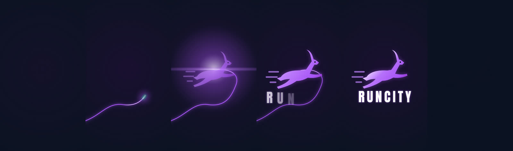

# Marca: icono e intro animada

Elegidos por Jhona el 26 de octubre de 2026: icono propuesta A "Gacela en ruta" e intro A "Ruta y destello" (estilo Netflix, 2,8 s). El mismo dia la intro paso a ser el video "Ruta y destello v2b" con la palabra RUNCITY (2,2 s).

## Paleta y tipografia

| Uso                                         | Color                 |
| ------------------------------------------- | --------------------- |
| Morado principal                            | `#7B1FA2`             |
| Morado brillante (ruta, brillo)             | `#A855F7`             |
| Morado claro                                | `#C084FC`             |
| Lila                                        | `#E9D5FF` y `#F3E8FF` |
| Fondo de marca (splash, intro, theme-color) | `#0C1322`             |
| Fondo profundo                              | `#070E1D`             |
| Acento GPS                                  | `#10B981`             |

Titulares en Anton cursiva (la palabra RUNCITY de la intro) y textos en Archivo. Desde la version 0.8.4 los titulares Anton llevan 0.04em mas de espaciado entre letras que el diseno original (por ejemplo 0.03em en lugar de -0.01em) y sin tracking negativo, para que se lean mejor. Se probo Saira Semi Condensed en la 0.8.3 y se descarto. Ver tambien docs/PALETA.md.

## Icono

Fuentes en `assets/marca/`: `icono.svg` (completo), `fondo.svg` y `primer_plano.svg` (capas del icono adaptativo, lienzo 108 x 108 con zona segura de 66).

- Fondo: degradado violeta a azul noche, halo morado y montanas de Loja.
- Primer plano: gacela en salto con estelas de velocidad sobre una ruta GPS punteada que termina en un punto verde.
- Monocromo (iconos tematicos de Android 13): gacela, estelas y ruta en una sola tinta.


### Archivos generados

| Plataforma | Archivo                                                                                                                |
| ---------- | ---------------------------------------------------------------------------------------------------------------------- |
| Android    | `res/drawable/ic_launcher_background.xml`, `ic_launcher_foreground.xml`, `ic_launcher_monochrome.xml` (VectorDrawable) |
| Android    | `res/mipmap-anydpi-v26/ic_launcher.xml` y `ic_launcher_round.xml` (adaptativo)                                         |
| Android    | `res/mipmap-{mdpi..xxxhdpi}/ic_launcher.png` y `ic_launcher_round.png` (Android 7)                                     |
| Android    | `res/drawable/splash_icono.xml` (icono del SplashScreen)                                                               |
| Play Store | `assets/marca/play_store_512.png`                                                                                      |
| Web        | `public/favicon.svg`, `favicon.ico`, `favicon-32.png`, `apple-touch-icon.png`                                          |
| Web (PWA)  | `public/icon-192.png`, `icon-512.png`, `icon-maskable-512.png` y `manifest.webmanifest`                                |

La notificacion de la carrera usa `ic_launcher_monochrome` como icono pequeno.

### Regenerar

Desde la raiz del repo, con Python 3, Pillow y Playwright (chromium):

```
python3 tools/marca/generar.py
```

Si se cambia el dibujo, editar los SVG de `assets/marca/` y las constantes del script (trazo de la gacela y de la ruta), que convierten los SVG a VectorDrawable. VectorDrawable no tiene filtros: el brillo neon de la ruta se aproxima con un halo semitransparente y la sombra de la gacela con una copia desplazada.

## Intro "Ruta y destello v2b" (video)

Aprobada por Jhona el 26 de octubre de 2026 (reemplaza a la intro A dibujada en tiempo real). Una ruta morada luminosa con un cometa entra directo, sin preambulo, estalla en un destello anamorfico al llegar al centro, revela la gacela con un brillo que la cruza y la palabra RUNCITY en Anton con espaciado amplio que se cierra, y se funde al fondo `#0C1322`. Dura 2,2 s.

Es un video pre-renderizado cuadro por cuadro a 60 fps (motion blur con 4 submuestras por cuadro, easing cuidado, grano leve contra el banding) con `tools/marca/render_intro.py b <carpeta>` (requiere `skia-python`, `numpy`, `pillow` y la fuente Anton). Exportacion, 720 x 1280, sin audio:

| Archivo                                                  | Formato                  | Peso   |
| -------------------------------------------------------- | ------------------------ | ------ |
| `apps/android/app/src/main/res/drawable/intro_marca.xml` | vector animado (Android) | 33 KB  |
| `apps/web/public/marca/intro.mp4`                        | H.264 main, CRF 24       | 102 KB |
| `apps/web/public/marca/intro.webm`                       | VP9, CRF 34              | 112 KB |

El primer y el ultimo cuadro son el fondo de marca `#0C1322`, igual que el SplashScreen, `windowBackground` y el theme-color de la web.



### Por que se cambio la intro A

- Corte entre splash e intro: el splash mostraba la gacela sobre `#0C1322` plano y la intro empezaba con un degradado violeta sin gacela; la gacela volvia recien a los 1,35 s.
- Tirones: la palabra se volvia a medir en cada cuadro de su entrada, el destello creaba un pincel nuevo por cuadro y la app se montaba durante la animacion en el hilo principal.
- Fuente: la intro dependia de la familia de titulares en Compose y, en web, de que la fuente del canvas ya estuviera cargada (si no, se dibujaba con Impact y saltaba a mitad).
- Web: `shadowBlur` en canvas es caro en moviles y la intro solo aparecia cuando ya habia cargado el bundle de React.

Un video se decodifica por hardware y se compone fuera del hilo principal, asi que lo que se ve es exactamente lo aprobado, en cualquier telefono.

### Cuando se muestra (regla comun Android y web)

La intro se ve cada vez que se abre la app:

- arranque en frio (proceso nuevo);
- volver a abrirla despues de salir con atras o de cerrarla desde recientes, aunque el proceso siga vivo y hayan pasado solo unos segundos (la actividad se crea de nuevo, sin estado guardado: siempre intro);
- traerla de segundo plano (inicio, recientes, notificacion) con la actividad todavia viva, si estuvo fuera al menos 30 s (`UMBRAL_AUSENCIA_MS`).

Si solo se trae de segundo plano tras menos de 30 s, o se rota la pantalla, no se repite: es un cambio rapido de app, no una apertura. (Hasta la v0.9.x la regla de 30 s se aplicaba tambien a las aperturas nuevas con el proceso vivo, y por eso al cerrar y reabrir rapido solo se veia el icono del splash.) Nunca se muestra con las animaciones del sistema desactivadas (Android: escala 0; web: `prefers-reduced-motion`).

### Android

En Android la intro no es un video sino un vector animado (`AnimatedVectorDrawable`), la misma tecnica que usan los splash animados de apps como Prime Video o Netflix. Desde Android 7.1 el sistema anima ese vector en el RenderThread: no necesita reproductor, ni decodificador de video, ni red, ni el hilo principal. Por eso empieza en el primer cuadro de la ventana y corre entera a 60 fps aunque la app este cargando debajo. En la v0.8.6 y v0.8.7 era un MP4 (Media3, luego `MediaPlayer`): el reproductor tardaba en dar su primer cuadro en arranque en frio y competia con el montaje de la app, por eso en telefono se trababa o salia cortada.

1. `Theme.Gacelas.Arranque` (SplashScreen API) muestra el fondo `#0C1322` con la gacela. El splash no se retiene: en el primer cuadro de la actividad ya corre la intro sobre el mismo `#0C1322` y `setOnExitAnimationListener` desvanece la gacela del splash encima en 180 ms.
2. `MainActivity` decide en `onCreate` (y en cada `onStart` posterior) con `IntroArranque.alEntrar(ahora, escalaAnimaciones, aperturaNueva = savedInstanceState == null)`, y registra la salida en `onStop` con `IntroArranque.alSalir(ahora)`. El reloj es `SystemClock.elapsedRealtime()`. La regla pura es `IntroArranque.debeMostrar(ahora, ultimaSalida, escala)`.
3. `IntroAnimada` (`app/.../intro/IntroAnimada.kt`) pone una `ImageView` nativa a pantalla completa encima de Compose (`addContentView`, `centerCrop`, fondo `#0C1322`) con `res/drawable/intro_marca.xml`. La animacion y el tope de seguridad arrancan en su primer dibujo real, no al crearla.

#### Causa del splash fijo de 5 s de la v0.8.9 (corregido en la v0.9.0)

En la v0.8.9 `GacelasRaiz` se componia en el primer cuadro y leia el contenedor de dependencias (Supabase, repositorios), que es `lazy` y se construye en segundo plano: el hilo principal quedaba esperando unos 5 s, el primer cuadro no salia y el splash seguia fijo. Mientras tanto vencia el tope de 3,7 s, que se contaba desde `onCreate`, asi que la intro se retiraba antes de verse. Ahora el primer cuadro es solo el fondo de marca con la intro, la app se monta cuando `GacelasApp.esperarContenedor()` termina, y el tope cuenta desde que la intro se dibuja. `MainActivity` y `GacelasApp` marcan `Trace` y registran en el log `Arranque` los tiempos (onCreate, inicio de la intro y app lista, en ms desde el inicio del proceso). 4. `intro_marca.xml` lo genera `tools/marca/generar_intro_avd.py` (ruta, cometa, destello, gacela y RUNCITY en Anton convertida a trazos, sin fuente en tiempo de ejecucion). Solo anima propiedades que corren en el RenderThread (`trimPathStart`, `trimPathEnd`, `fillAlpha`, `strokeAlpha`, `scaleX`, `scaleY`, `translateX`, `translateY`); si una no lo fuera, todo el vector pasaria al hilo principal. `IntroMarcaTest` lo comprueba. `tools/marca/previsualizar_intro_avd.py` dibuja cuadros del vector para revisarlo sin telefono. 5. La intro no se corta porque la app este lista: termina cuando el vector avisa su fin (`onAnimationEnd`, 2,2 s) o con un toque, y siempre sale con un fundido de 160 ms (`FUNDIDO_SALIDA_MS`). Hay un tope de seguridad de 3,7 s (`IntroArranque.TOPE_MS`). `ControlIntro` garantiza que el fin ocurra una sola vez. 6. La app (`GacelasRaiz`) se monta enseguida, debajo de la intro: el trabajo del hilo principal no frena la animacion. La preparacion del mapa sin conexion se aplaza 3 s. El vector pesa unos 33 KB y no hay nada que precargar: viene dentro del APK. 7. `app/src/main/baseline-prof.txt` con `androidx.profileinstaller` sigue compilando AOT el arranque y la primera pantalla.

iOS todavia no muestra la intro. Para hacerlo, `MainViewController` puede reproducir `public/marca/intro.mp4` con `AVPlayerLayer` y la misma regla de `IntroArranque` (codigo comun en `core/ui`).

`core/ui/.../ui/intro/Marca.kt` conserva la paleta y la silueta de la gacela que usa el icono dibujado en la app.

#### Causa del fallo de la v0.8.1 (corregido en la v0.8.2)

- Solo salia la primera vez: la regla usaba una bandera por proceso (`mostradaEnProceso`). Al salir con atras Android conserva el proceso, asi que al reabrir la bandera seguia activa.
- Pantalla oscura un buen rato: la intro se componia en el mismo cuadro que toda la app. Ademas `windowBackground` (`#111827`) no coincidia con el splash (`#0C1322`).

### Web

La intro es un `<video autoplay muted playsinline preload="auto">` en `index.html`, fuera de React, dentro de `#intro` (fondo `#0C1322`, `object-fit: cover`, `data-testid="intro-animada"`), con WebM VP9 y MP4 de respaldo (`preload="auto"`). Se ve antes de que cargue el bundle de la app.

- Un script en linea en `index.html` aplica la misma regla que `debeMostrarIntro` (`src/shared/lib/intro.ts`): se muestra al abrir salvo si se salio hace menos de 30 s, y nunca con `prefers-reduced-motion: reduce`. `localStorage`, clave `gacelas.intro.vista`, guarda el instante de la ultima salida.
- `src/shared/lib/introVideo.ts` (`iniciarIntroVideo`, cargado por su propia entrada diminuta `src/app/introArranque.ts`, antes y sin esperar a `main.tsx`) la oculta al terminar (`ended`), con clic, toque o cualquier tecla, si el video falla, si no hay primer cuadro en 1 s (fallback, por ejemplo autoplay bloqueado) o por un tope de 3,7 s; y la repite al volver a la pestana tras 30 s o mas fuera (`visibilitychange`, `pagehide`).
- La app carga debajo mientras tanto.

## Logo dentro de la app

El logo anterior (cuadro naranja con el corredor de Material o el simbolo `sprint`, y el PNG naranja `82a3eb8346b4.png` / `compartir_logo.png`) se reemplazo por el icono A en todas las pantallas:

- Android: `IconoGacelas` y `MarcaGacelasA` (core/ui `components/IconoGacelas.kt`), dibujados en Compose con la misma gacela que la intro. Se usan en `MarcaGacelas`, la cabecera de acceso (`MarcaC4`: bienvenida, inicio de sesion, registro), la cabecera del modal de actualizacion, el dialogo Acerca de e `InicioComun` (iOS).
- Web: `IconoGacelas` y `LogoGacelas` (`src/shared/ui/LogoGacelas.tsx`, usa `/favicon.svg`) en bienvenida, inicio de sesion y registro.
- Imagenes de compartir: `compartir_logo.png` (Android) y `public/marca/logo-compartir.png` (web), generados desde el icono A.
- Tarjeta Open Graph `public/og-default.png` (1200 x 630): icono A con la palabra GACELAS.
- Las plantillas de correo (`supabase/templates`) no llevan logo grafico.

Todo sale de `python3 tools/marca/generar.py`. Capturas antes y despues: `/workspace/gacelas/marca/implementado/logo-interno/`.

## Pruebas

| Prueba                             | Que verifica                                                                                                                                                      |
| ---------------------------------- | ----------------------------------------------------------------------------------------------------------------------------------------------------------------- |
| `core/ui` `IntroArranqueTest`      | arranque en frio, regla de 30 s, ciclo salir y volver, animaciones desactivadas, saltar, duracion, tope de 3,7 s                                                  |
| `app` `IntroMarcaTest` (Roborazzi) | `ControlIntro` (un solo fin), vector solo con propiedades del RenderThread y 2,2 s exactos, no se corta a mitad, salto con toque y fundido, fondo igual al splash |
| web `introVideo.test.ts`           | regla de 30 s, fin por `ended`, salto con clic y tecla, fallback sin primer cuadro y por error, tope de seguridad                                                 |
| web `e2e/intro.spec.ts`            | aparece sobre `#0C1322`, se salta, no reaparece al recargar enseguida, termina sola, fallback sin video, movimiento reducido, manifest e iconos                   |

Los demas e2e dan la intro por vista (`e2e/ayuda.ts`). Capturas de Roborazzi: `./gradlew :app:testDebugUnitTest --tests '*IntroMarca*' -Proborazzi.test.record=true -Pgacelas.shots=<carpeta>`.
