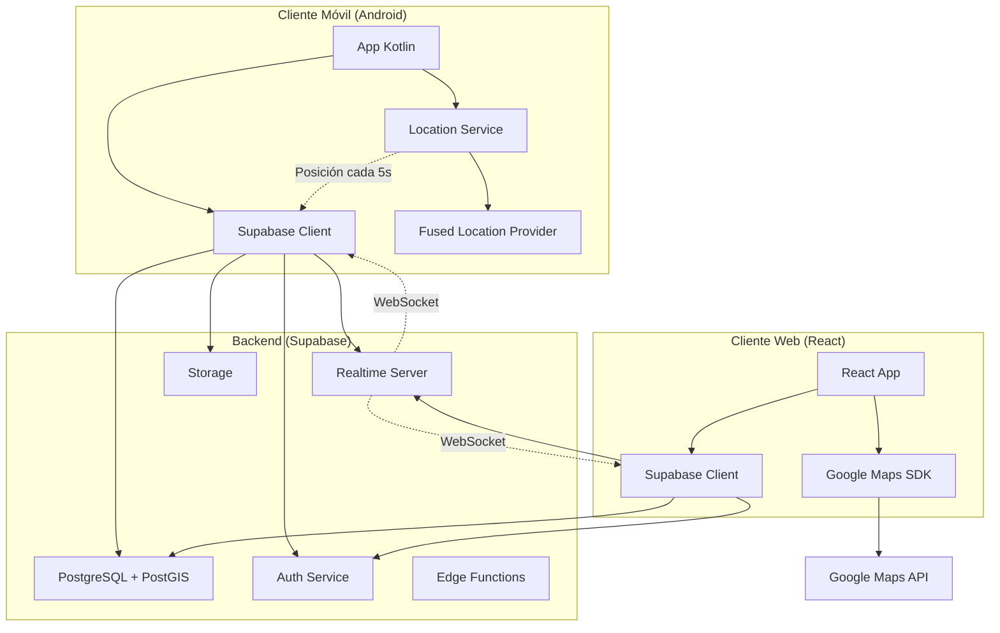
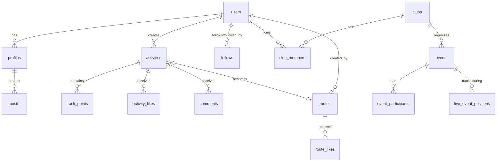
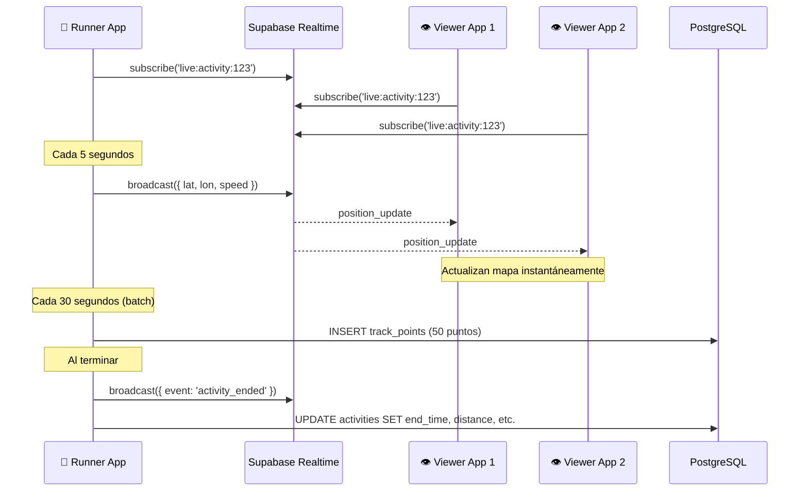

# Arquitectura del Sistema - Gacelas

## Visión General

Gacelas es una aplicación distribuida con arquitectura cliente-servidor, optimizada para streaming de datos de ubicación en tiempo real con restricciones de tier gratuito.



## Stack Tecnológico Completo

### Frontend Web
- **Framework**: React 18.2+ con TypeScript 5.0+
- **Build tool**: Vite 5.0+
- **Styling**: Tailwind CSS 3.4+
- **State management**: Zustand (ligero, simple)
- **Maps**: Google Maps JavaScript API
- **Realtime**: Supabase Realtime Client
- **Routing**: React Router 6+
- **Forms**: React Hook Form + Zod
- **HTTP**: Fetch API (nativo)

### Mobile Android
- **Lenguaje**: Kotlin 1.9+
- **UI**: Jetpack Compose
- **Arquitectura**: Clean Architecture (MVVM + Use Cases)
- **DI**: Hilt (Dagger)
- **Networking**: Ktor Client
- **Maps**: Google Maps SDK Android
- **Location**: Fused Location Provider
- **Realtime**: Supabase Kotlin SDK
- **Database local**: Room (caché offline)
- **Navigation**: Compose Navigation

### Backend (Supabase)
- **Base de datos**: PostgreSQL 15+ con extensión PostGIS
- **Realtime**: Supabase Realtime (Phoenix Channels)
- **Auth**: Supabase Auth (JWT + RLS)
- **Storage**: Supabase Storage (imágenes de perfil, fotos de actividades)
- **Functions**: Supabase Edge Functions (Deno/TypeScript)
- **Geospatial**: PostGIS 3.4+

## Arquitectura de Datos

### Modelo Relacional



### Tablas Principales

#### `users` (Supabase Auth)
```sql
-- Tabla gestionada por Supabase Auth
id: uuid (PK)
email: text
created_at: timestamp
```

#### `profiles`
```sql
id: uuid (PK, FK -> users.id)
username: text (unique)
full_name: text
avatar_url: text
bio: text
location: text
privacy_level: enum ('public', 'followers', 'private')
created_at: timestamp
updated_at: timestamp
```

#### `activities`
```sql
id: uuid (PK)
user_id: uuid (FK -> users.id)
title: text
description: text
activity_type: enum ('run', 'walk', 'hike', 'bike')
start_time: timestamp
end_time: timestamp
distance_meters: integer
duration_seconds: integer
avg_pace_seconds_per_km: integer
elevation_gain_meters: integer
calories: integer
is_public: boolean
started_location: geography(Point, 4326)  -- PostGIS
ended_location: geography(Point, 4326)
route_id: uuid (FK -> routes.id, nullable)
created_at: timestamp
```

#### `track_points`
```sql
id: uuid (PK)
activity_id: uuid (FK -> activities.id)
location: geography(Point, 4326)  -- PostGIS: lat, lon
elevation_meters: float
timestamp: timestamp
accuracy_meters: float
speed_mps: float
bearing_degrees: float
```

Índice espacial:
```sql
CREATE INDEX track_points_location_idx 
ON track_points 
USING GIST (location);
```

#### `routes` (Rutas guardadas y compartibles)
```sql
id: uuid (PK)
user_id: uuid (FK -> users.id)
name: text
description: text
distance_meters: integer
elevation_gain_meters: integer
difficulty: enum ('easy', 'moderate', 'hard')
route_type: enum ('loop', 'out_and_back', 'point_to_point')
surface: enum ('road', 'trail', 'mixed')
start_location: geography(Point, 4326)
is_public: boolean
created_at: timestamp
```

#### `route_points`
```sql
id: uuid (PK)
route_id: uuid (FK -> routes.id)
location: geography(Point, 4326)
sequence: integer  -- Orden de los puntos
elevation_meters: float
```

#### `follows`
```sql
id: uuid (PK)
follower_id: uuid (FK -> users.id)
followed_id: uuid (FK -> users.id)
status: enum ('pending', 'accepted')
created_at: timestamp

UNIQUE(follower_id, followed_id)
```

#### `clubs`
```sql
id: uuid (PK)
name: text
description: text
location: text
avatar_url: text
is_public: boolean
created_by: uuid (FK -> users.id)
created_at: timestamp
```

#### `events`
```sql
id: uuid (PK)
club_id: uuid (FK -> clubs.id, nullable)
title: text
description: text
event_type: enum ('group_run', 'race', 'training')
start_time: timestamp
meeting_point: geography(Point, 4326)
distance_meters: integer
max_participants: integer (nullable)
is_public: boolean
created_by: uuid (FK -> users.id)
created_at: timestamp
```

## Arquitectura de Streaming en Tiempo Real

### Problema a Resolver

Un corredor genera ~1,200 puntos GPS en una hora (1 punto cada 3 segundos). Si 10 personas lo siguen en vivo, eso es:
- **12,000 escrituras/hora** si persiste cada punto
- **120,000 lecturas/hora** si cada seguidor consulta polling
- **$$$** en tier de pago, o **excede límite** en tier gratuito

### Solución: Arquitectura Híbrida

#### 1. **Broadcast Efímero** para Live Tracking (NO persiste)

```typescript
// Corredor envía posición cada 5s (no cada 3s)
const liveChannel = supabase.channel(`live:activity:${activityId}`)

await liveChannel.subscribe()

// Enviar posición (solo va a suscriptores, NO se guarda en DB)
await liveChannel.send({
  type: 'broadcast',
  event: 'position_update',
  payload: {
    userId: currentUser.id,
    lat: 0.315653,
    lon: -78.550341,
    speed: 3.2,  // m/s
    bearing: 145,
    timestamp: Date.now()
  }
})
```

**Ventajas:**
- ✅ Sin cargo de escrituras/lecturas de DB
- ✅ Latencia <500ms
- ✅ Escala a 100+ espectadores sin costo adicional
- ✅ Limpieza automática al desconectar

**Desventajas:**
- ❌ Si pierdes conexión, pierdes datos (aceptable para live)

#### 2. **Batch Inserts** para Track Persistido

```typescript
// Buffer local en app móvil
const pointsBuffer: TrackPoint[] = []

// Cada 3 segundos: agregar al buffer
locationSubscription.on('location', (location) => {
  pointsBuffer.push({
    lat: location.latitude,
    lon: location.longitude,
    elevation: location.altitude,
    timestamp: location.timestamp,
    accuracy: location.accuracy,
    speed: location.speed,
    bearing: location.bearing
  })
})

// Cada 30 segundos O cada 50 puntos: flush a DB
if (pointsBuffer.length >= 50 || lastFlush > 30_000) {
  await supabase.from('track_points').insert(
    pointsBuffer.map(p => ({
      activity_id: currentActivityId,
      location: `POINT(${p.lon} ${p.lat})`,
      elevation_meters: p.elevation,
      timestamp: p.timestamp,
      accuracy_meters: p.accuracy,
      speed_mps: p.speed,
      bearing_degrees: p.bearing
    }))
  )
  pointsBuffer = []
}
```

**Resultado:**
- 1 hora de carrera (1,200 puntos) = **40 batch inserts** en lugar de 1,200 individuales
- Reduce escrituras en 97%
- Al terminar, la ruta completa está guardada para replay

#### 3. **Offline Buffering** para Zonas sin Cobertura

```kotlin
// Android: WorkManager para retry automático
class SyncTrackPointsWorker(context: Context, params: WorkerParameters) 
    : CoroutineWorker(context, params) {
    
    override suspend fun doWork(): Result {
        val pendingPoints = localDatabase.getPendingTrackPoints()
        
        return try {
            supabase.from("track_points").insert(pendingPoints)
            localDatabase.markAsSynced(pendingPoints)
            Result.success()
        } catch (e: Exception) {
            if (runAttemptCount < 3) Result.retry()
            else Result.failure()
        }
    }
}
```

### Diagrama de Flujo: Live Tracking



## Estrategia de Batería y Frecuencia

### Configuración del Location Service (Android)

```kotlin
val locationRequest = LocationRequest.Builder(
    Priority.PRIORITY_HIGH_ACCURACY,
    intervalMillis = 3000  // 3 segundos
).apply {
    setMinUpdateIntervalMillis(1000)  // Mínimo 1s
    setMaxUpdateDelayMillis(5000)     // Máximo delay 5s
    setWaitForAccurateLocation(false) // No esperar precisión perfecta
}.build()
```

### Estrategia Adaptativa

```kotlin
fun adjustLocationFrequency(speed: Float) {
    val interval = when {
        speed < 1.0 -> 10000  // Detenido: cada 10s
        speed < 2.0 -> 5000   // Caminando: cada 5s
        else -> 3000          // Corriendo: cada 3s
    }
    updateLocationInterval(interval)
}
```

**Ahorro estimado:**
- 1 hora de carrera activa: ~1,200 puntos (3s cada uno)
- 1 hora de caminata lenta: ~720 puntos (5s cada uno)
- 1 hora pausa: ~360 puntos (10s cada uno)

### Optimización de Batería

1. **Usar Fused Location Provider**: Combina GPS, Wi-Fi, y cell tower
2. **Foreground service con notificación**: Android permite alta prioridad
3. **Apagar pantalla**: Permitir que el teléfono duerma
4. **Detener al terminar**: Liberar GPS inmediatamente
5. **Background restrictions**: Advertir usuario si hay restricciones

## Privacidad y Control de Compartición

### Niveles de Privacy

```sql
CREATE TYPE privacy_level AS ENUM (
    'public',      -- Cualquiera puede ver
    'followers',   -- Solo seguidores aceptados
    'private'      -- Solo el usuario
);
```

### Reglas de Live Sharing

1. **Opt-in explícito**: Live sharing OFF por defecto
2. **Control granular**: 
   - Compartir con todos los seguidores
   - Compartir con un grupo/evento específico
   - Compartir con link temporal
3. **Home zone fuzzing**: Ocultar primeros/últimos 300m
4. **Auto-stop**: Detener compartición al terminar actividad

### Implementación: Home Zone Hiding

```typescript
function fuzzLocation(
  point: { lat: number; lon: number },
  homeLocation: { lat: number; lon: number },
  fuzzyRadius: number = 300 // metros
): { lat: number; lon: number } {
  const distance = calculateDistance(point, homeLocation)
  
  if (distance < fuzzyRadius) {
    // Desplazar punto al borde del círculo de privacidad
    const bearing = calculateBearing(homeLocation, point)
    return movePoint(homeLocation, fuzzyRadius, bearing)
  }
  
  return point
}
```

## Consultas Geoespaciales con PostGIS

### Buscar Rutas Cercanas

```sql
SELECT 
    r.id,
    r.name,
    r.distance_meters,
    ST_Distance(r.start_location, ST_MakePoint(-78.550341, 0.315653)::geography) as distance_meters
FROM routes r
WHERE 
    r.is_public = true
    AND ST_DWithin(
        r.start_location,
        ST_MakePoint(-78.550341, 0.315653)::geography,  -- Mi ubicación
        5000  -- Radio de 5km
    )
ORDER BY distance_meters ASC
LIMIT 20;
```

### Encontrar Corredores Activos Cerca

```sql
-- Usando tabla temporal live_positions (Realtime Presence)
SELECT 
    p.user_id,
    prof.username,
    ST_Distance(
        ST_MakePoint(p.lon, p.lat)::geography,
        ST_MakePoint(-78.550341, 0.315653)::geography
    ) as distance_meters
FROM live_positions p
JOIN profiles prof ON p.user_id = prof.id
WHERE 
    p.last_updated > NOW() - INTERVAL '30 seconds'  -- Activo recientemente
    AND ST_DWithin(
        ST_MakePoint(p.lon, p.lat)::geography,
        ST_MakePoint(-78.550341, 0.315653)::geography,
        10000  -- Radio de 10km
    )
ORDER BY distance_meters;
```

### Calcular Elevación Total de Ruta

```sql
SELECT 
    r.id,
    r.name,
    SUM(
        CASE 
            WHEN rp2.elevation_meters > rp1.elevation_meters 
            THEN rp2.elevation_meters - rp1.elevation_meters 
            ELSE 0 
        END
    ) as total_elevation_gain
FROM routes r
JOIN route_points rp1 ON r.id = rp1.route_id
JOIN route_points rp2 ON r.id = rp2.route_id 
    AND rp2.sequence = rp1.sequence + 1
WHERE r.id = 'route-uuid-here'
GROUP BY r.id, r.name;
```

## Row Level Security (RLS)

### Política: Actividades Privadas

```sql
-- Solo el dueño puede ver sus actividades privadas
CREATE POLICY "Users can view own private activities"
ON activities FOR SELECT
USING (
    user_id = auth.uid() 
    OR is_public = true
    OR (
        is_public = false 
        AND user_id IN (
            SELECT followed_id FROM follows 
            WHERE follower_id = auth.uid() 
            AND status = 'accepted'
        )
    )
);

-- Solo el dueño puede actualizar sus actividades
CREATE POLICY "Users can update own activities"
ON activities FOR UPDATE
USING (user_id = auth.uid());
```

### Política: Track Points

```sql
-- Track points heredan privacidad de la actividad
CREATE POLICY "View track points of accessible activities"
ON track_points FOR SELECT
USING (
    activity_id IN (
        SELECT id FROM activities 
        WHERE user_id = auth.uid() 
           OR is_public = true
    )
);
```

## Edge Functions

### Función: Calcular Estadísticas Post-Actividad

```typescript
// backend/functions/calculate-activity-stats.ts
import { serve } from "https://deno.land/std@0.177.0/http/server.ts"
import { createClient } from "https://esm.sh/@supabase/supabase-js@2"

serve(async (req) => {
  const { activityId } = await req.json()
  const supabase = createClient(...)
  
  // Obtener todos los track points
  const { data: points } = await supabase
    .from('track_points')
    .select('*')
    .eq('activity_id', activityId)
    .order('timestamp', { ascending: true })
  
  // Calcular métricas
  let totalDistance = 0
  let elevationGain = 0
  
  for (let i = 1; i < points.length; i++) {
    totalDistance += calculateDistance(points[i-1], points[i])
    const elevDiff = points[i].elevation_meters - points[i-1].elevation_meters
    if (elevDiff > 0) elevationGain += elevDiff
  }
  
  const duration = points[points.length-1].timestamp - points[0].timestamp
  const avgPace = (duration / 1000) / (totalDistance / 1000)  // seg/km
  
  // Actualizar actividad
  await supabase.from('activities').update({
    distance_meters: Math.round(totalDistance),
    duration_seconds: Math.round(duration / 1000),
    avg_pace_seconds_per_km: Math.round(avgPace),
    elevation_gain_meters: Math.round(elevationGain)
  }).eq('id', activityId)
  
  return new Response(JSON.stringify({ success: true }))
})
```

## Límites del Free Tier y Mitigaciones

Ver [FREE_TIER_BUDGET.md](FREE_TIER_BUDGET.md) para análisis detallado.

### Resumen de Límites (Supabase Free Tier)

- **Database**: 500 MB (suficiente para ~8,000 actividades completas)
- **Bandwidth**: 5 GB/mes (~166 MB/día)
- **Storage**: 2 GB para imágenes
- **Realtime**: 200 conexiones concurrentes (más que suficiente)

### Mitigaciones

1. **Compresión de track points**: Algoritmo Douglas-Peucker para reducir puntos sin perder forma
2. **Limpieza de datos viejos**: Eliminar track_points de actividades >6 meses (mantener resumen)
3. **Lazy loading**: Solo cargar track completo cuando usuario lo solicita
4. **CDN para mapas**: Cache de tiles de Google Maps

## Monitoreo y Alertas

### Métricas Críticas

1. **Latencia de broadcast**: Tiempo entre envío y recepción de posición
2. **Tasa de éxito de inserts**: % de batches que se guardan exitosamente
3. **Uso de bandwidth**: Acercamiento al límite de 5 GB/mes
4. **Conexiones activas**: Número de usuarios en live tracking simultáneo

### Dashboard Supabase

Revisar diariamente:
- Database size (mantener <450 MB)
- Bandwidth usage (mantener <4.5 GB/mes)
- Query performance (identificar queries lentos)

## Escalabilidad Futura

Cuando se alcancen los límites del free tier:

1. **Upgrade a Supabase Pro**: $25/mes
   - 8 GB base de datos
   - 50 GB bandwidth
   - 100 GB storage

2. **Optimizaciones adicionales**:
   - Sharding por región geográfica
   - Read replicas para consultas
   - Redis para caché de rutas populares

3. **Self-hosting** (si el crecimiento lo justifica):
   - PostgreSQL + PostGIS en VPS
   - Supabase Realtime autohosted
   - Costo: ~$50/mes en DigitalOcean/Linode

## Referencias Técnicas

- [Supabase Realtime](https://supabase.com/docs/guides/realtime)
- [PostGIS Documentation](https://postgis.net/docs/)
- [Android Location Services](https://developer.android.com/training/location)
- [Google Maps Platform](https://developers.google.com/maps/documentation)
- [Fused Location Provider](https://developers.google.com/location-context/fused-location-provider)
