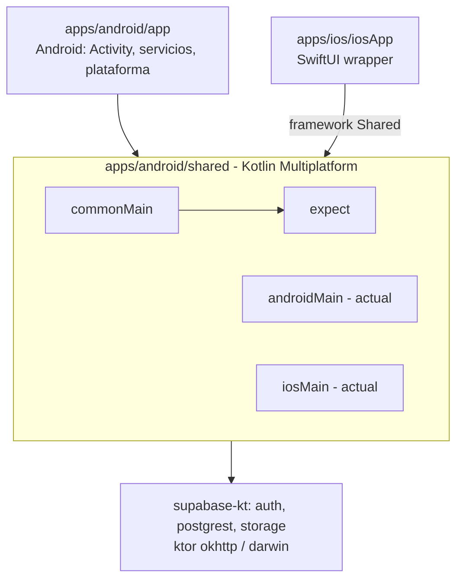
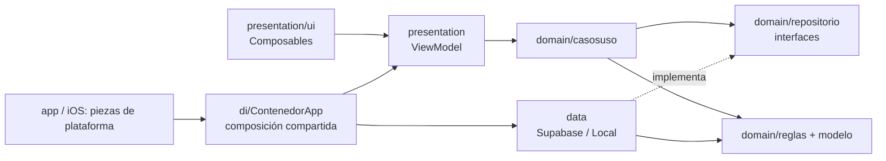

# Arquitectura móvil (KMP, Android, iOS)

Volver a [ARQUITECTURA.md](../ARQUITECTURA.md).

## Módulos



- `shared`: lógica, ViewModels y la mayor parte de la UI en Compose Multiplatform. Paquete raíz `com.gacelas`.
- `app` (Android): punto de entrada (`GacelasApp`, `MainActivity`), servicios de tracking y notificaciones, pantallas que aún no se movieron a `shared`.
- `iosApp`: `iOSApp.swift` aloja `MainViewController` de `shared`; `MapaMapLibre.swift` y `AccesoNativo.swift` aportan integración nativa (mapa, inicio de sesión).

## Capas por bounded context (objetivo)

Cada contexto (`carreras`, `rutas`, `cuenta`, `comunidad`) en `shared/src/commonMain/kotlin/com/gacelas/<contexto>/`:

```
<contexto>/
  domain/
    modelo/        entidades y value objects (data class inmutables)
    reglas/        lógica pura: cálculos, validaciones, políticas
    repositorio/   interfaces (puertos) que data implementa
    casosuso/      un caso de uso por acción (clase con operator fun invoke)
  data/
    Supabase<X>Repository.kt   implementación remota
    Local<X>Repository.kt      caché / offline / fake
    dto/                       DTO @Serializable y mapeadores toDomain()/toDto()
  presentation/
    <Pantalla>ViewModel.kt     estado (StateFlow<UiState>) + eventos
    ui/                        Composables comunes del contexto
```



### Reglas de dependencias

| Capa                         | Puede depender de                                                                                         | No puede depender de                                                   |
| ---------------------------- | --------------------------------------------------------------------------------------------------------- | ---------------------------------------------------------------------- |
| `domain`                     | Kotlin estándar, `kotlinx.coroutines` (Flow), `kotlinx.datetime`, `com.gacelas.shared` (utilidades puras) | `data`, `presentation`, Compose, supabase-kt, ktor, APIs de plataforma |
| `data`                       | `domain` del mismo contexto, supabase-kt, ktor, serialización, `expect` de plataforma                     | `presentation`, Compose                                                |
| `presentation`               | `domain` del mismo contexto, lifecycle-viewmodel, Compose                                                 | `data` (recibe repositorios por constructor), supabase-kt              |
| `androidMain` / `iosMain`    | cualquier capa de `commonMain`                                                                            | otros source sets                                                      |
| `apps/android/app`, `iosApp` | `shared` completo (punto de composición)                                                                  | contener reglas de negocio                                             |

- La inyección es manual por constructor, sin librería de DI. El ensamblado vive en un contenedor compartido: `shared/src/commonMain/kotlin/com/gacelas/di/ContenedorApp.kt`. Crea los repositorios (`Supabase<X>Repository` si hay backend, `Local<X>Repository` si no), la `SesionCarrera` en curso y expone fábricas de ViewModels (`loginViewModel()`, `listaRutasViewModel(...)`, `carreraEnCursoViewModel()`, etc.) que las pantallas usan dentro de `viewModel { ... }`.
- Las piezas de plataforma entran por parámetro del constructor: `store` (DataStore), `backend` (Supabase ya configurado o `null`), `actualizacion` (aviso de versión, solo Android) y `programarSincronizacion` (WorkManager en Android).
- Android: `GacelasApp` crea un único `ContenedorApp` (alias `Contenedor`) y las pantallas lo obtienen con `contenedor()`; `LocationService` y `MainActivity` usan el mismo `tracker`.
- iOS: `SesionIos` (iosMain) crea el `ContenedorApp` con el DataStore de Documents y las claves de `Info.plist`; `MainViewController()` (usado por el wrapper SwiftUI de `apps/ios/iosApp`) toma de ahí repositorios y ViewModels. iOS guarda los ajustes solo en local (`ajustesLocales`) y aún no descarga datos al iniciar sesión (`descargarAlEntrar = false`).
- Si crece, evaluar Koin en un ADR.
- Los ViewModels exponen `StateFlow<UiState>` inmutable y reciben acciones como funciones; la UI no llama a repositorios.

### expect/actual

Solo para capacidades de plataforma: sensores (`core/sensores`), fuentes (`ui/theme/Fuentes`), botón atrás (`correr/Atras`), formato decimal (`rutas/Decimal`), imágenes de acceso, mapa (`mapa`, con puente a MapLibre en iOS), utilidades de plataforma (`shared/Plataforma`, `shared/Comun`).

- Archivo `X.kt` en `commonMain` con `expect`; `X.android.kt` y `X.ios.kt` con `actual`.
- Preferir una interfaz en `domain`/`data` implementada por plataforma cuando la capacidad necesita estado o ciclo de vida; usar `expect fun` solo para funciones simples.
- Las vistas nativas iOS (MapLibre) se exponen a Compose mediante un puente (`PuenteMapa.kt`) que el lado Swift registra al arrancar.

## Convenciones de nombres

- Código y carpetas en español, salvo términos técnicos fijados por el patrón: `domain`, `data`, `presentation`, `Repository`, `ViewModel`.
- Paquetes en minúsculas sin guiones: `com.gacelas.rutas.domain.casosuso`.
- Repositorios: interfaz `RutasRepository`, implementaciones `SupabaseRutasRepository`, `LocalRutasRepository`.
- Casos de uso: verbo + objeto (`ObtenerCarrera`, `EliminarCarrera`, `MarcarVuelta`), un archivo por caso de uso o agrupados en `CasosUso<Contexto>.kt` si son triviales.
- ViewModels: `<Pantalla>ViewModel`; estado `<Pantalla>UiState`.
- Composables de pantalla: `<Pantalla>Contenido` (sin estado, recibe UiState y lambdas).
- Tests en `commonTest/kotlin/com/gacelas/<contexto>/` con el mismo paquete que el código probado; `domain` se prueba sin fakes de red.

## Estado actual

| Contexto    | domain                                                              | data                                                             | presentation                                                                                   | Comentario                                                                     |
| ----------- | ------------------------------------------------------------------- | ---------------------------------------------------------------- | ---------------------------------------------------------------------------------------------- | ------------------------------------------------------------------------------ |
| `carreras`  | Sí (`modelo`, `reglas`, `repositorio`, `casosuso`, `SesionCarrera`) | Sí (`Supabase`/`Local`)                                          | Sí (`ViewModelsCarreras.kt`)                                                                   | Migrado (PR de Clean Architecture 1-2)                                         |
| `rutas`     | Sí                                                                  | Sí (incluye offline, trazos, elevación)                          | Sí (`ViewModelsRutas.kt`)                                                                      | Migrado (#60); `ListaRutasContenido.kt` sigue en la raíz del contexto          |
| `cuenta`    | No                                                                  | En `data/auth`, `data/ajustes`, `data/notificaciones`            | En `acceso/`, `ajustes/`, `perfil/`                                                            | Pendiente                                                                      |
| `comunidad` | Sí (`modelo`, `reglas`, `repositorio`)                              | Sí (`Local`/`Supabase` eventos, clubes, en vivo, notificaciones) | Sí (`EventosViewModel`, `NotificacionesViewModel`, `ClubesViewModel`, feed, detalle y en vivo) | Migrado (#63, #67, #68); UI en `comunidad/presentation/ui`, compartida con iOS |

Otras carpetas de `commonMain` hoy: `di` (contenedor de dependencias), `correr`, `tracking`, `mapa`, `inicio`, `navigation`, `ui` (tema, componentes, 3D), `core/sensores`, `actualizacion`, `acceso`, `ajustes`, `perfil` (UI de cuenta), `data/remoto` (cliente Supabase compartido), `data/mock`.

Desviaciones detectadas:

- `data/mock` y pantallas como `Fase5Screens.kt` aún usan nombres por fase/temporales en lugar de por contexto.
- Comunidad (feed, eventos, clubes, en vivo, notificaciones) ya tiene ViewModels y UI en `shared` y la usan Android e iOS (#67, #68). Dibujar ruta también es compartido (`DibujarRutaViewModel`, #69) y el corredor 3D de Inicio usa en iOS el mismo GLB, clips y cámara que Android (SceneKit + GLTFKit2, #70). Otras pantallas Android (`rutas/DetalleRuta.kt`, `perfil/DetalleCarrera.kt`) siguen con lógica propia que iOS no comparte.

## Qué falta para el objetivo

1. Contexto `cuenta` (capas creadas en #61): mover la UI de `acceso`, `ajustes`, `perfil` a `cuenta/presentation/ui`, `data/notificaciones` a `cuenta/data` y añadir `domain/casosuso` cuando haya lógica más allá del repositorio.
2. Contexto `comunidad`: hecho (#63, #67, #68). ViewModels y UI en `shared`; Android e iOS solo aportan aviso, compartir y mapa.
3. Mover `ListaRutasContenido.kt` a `rutas/presentation/ui` y las pantallas de carrera (`correr`) a `carreras/presentation/ui`.
4. Reducir `apps/android/app` a composición, servicios Android y permisos; mover pantallas a `shared` para que iOS las reciba.
5. Añadir una comprobación automática de capas (por ejemplo un test con Konsist, o un script `rg` en CI que falle si un archivo de `*/domain/*` importa `io.github.jan.supabase`, `io.ktor`, `androidx.compose` o `*.data.*`).
6. Tests de `domain` y ViewModels para `cuenta` en `commonTest` (comunidad ya tiene `ComunidadTest`); ampliar cobertura de los ViewModels de feed, detalle y en vivo (#67).
