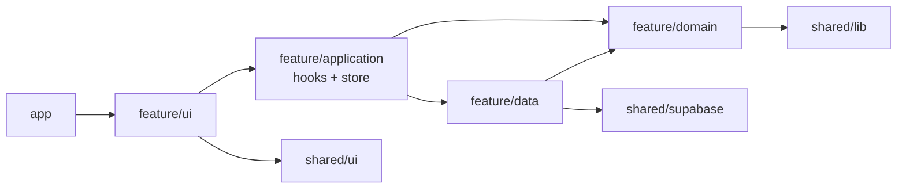

# Arquitectura web (`apps/web`)

Volver a [ARQUITECTURA.md](../ARQUITECTURA.md).

## Estado actual

- React 18 + TypeScript + Vite, React Router 6, Zustand, Tailwind, supabase-js, Google Maps (`@vis.gl/react-google-maps`), three / react-three-fiber.
- Tests: Vitest + Testing Library (`src/__tests__`, `src/lib/__tests__`, `src/data/__tests__`) y Playwright (`e2e/`).
- Funciones serverless de Vercel en `api/` (imágenes Open Graph para compartir).

```
src/
  main.tsx, App.tsx       arranque y rutas
  features/<feature>/     pantallas por funcionalidad (acceso, ajustes, comunidad, correr, inicio, notificaciones, perfil, rutas)
  components/             componentes compartidos (layout, mapas, diálogos, ui.tsx)
  lib/                    ~25 módulos planos: lógica (estadisticas, rachas, geo, rutas), servicios (supabase, enVivo, runTracker) y utilidades
  data/                   repositorios (repositorios.ts interfaz, supabaseRepos.ts implementación, tipos.ts)
  store/                  Zustand (app.ts, carrera.ts)
  mocks/, test/           datos de ejemplo y utilidades de test
```

Problemas: `lib/` mezcla reglas de negocio, acceso a datos y utilidades de UI; las pantallas de `features` importan `lib/supabase` y stores directamente; no hay frontera clara entre contextos.

## Rutas públicas

- `/`: landing (`src/app/landing/`). Sin sesión muestra la presentación de Runcity; con sesión, `SoloInvitados` redirige a `/inicio`. La app instalada como PWA (`display-mode: standalone`) salta la landing y va a `/bienvenida`, porque el `start_url` del manifest es `/`.
- `/bienvenida`, `/inicio-sesion`, `/registro`, `/recuperar-contrasena`: acceso, solo para invitados.
- `/legal/terminos` y `/legal/privacidad`: documentos legales, públicos y sin modales (ver [LEGAL.md](../LEGAL.md)).

La landing usa los tokens de [PALETA.md](../PALETA.md) y las clases C2 de `index.css` (`tarjeta-c2`, `boton-c2`, `escenario-c2`); los datos que muestra (rutas de Loja, reglas de privacidad) salen de [RUTAS-LOJA.md](../RUTAS-LOJA.md) y [BUSINESS_RULES.md](../BUSINESS_RULES.md).

## Arquitectura recomendada: feature-based con capas

Las features se agrupan por los mismos bounded contexts que móvil y base de datos.

```
src/
  app/                    composición: main.tsx, App.tsx, router, providers, layout
  features/
    carreras/             correr, en vivo, estadísticas, rachas
    rutas/
    cuenta/               acceso, perfil, ajustes, notificaciones
    comunidad/            feed, clubes, eventos, corredores
      domain/             tipos y reglas puras (sin React ni supabase)
      data/               repositorios: interfaz + implementación Supabase, mapeo de filas
      application/        hooks de caso de uso y stores Zustand del contexto
      ui/                 componentes y páginas del contexto
      index.ts            API pública del contexto
  shared/
    ui/                   componentes genéricos (botones, campos, diálogos, mapa)
    lib/                  utilidades puras (geo, fechas, teclado)
    supabase/             cliente único y tipos generados
  test/
```



### Reglas de dependencias

- `domain`: solo TypeScript y `shared/lib`. Sin React, Zustand ni supabase-js. Equivale a `domain/reglas` de KMP; mantener nombres paralelos facilita portar reglas.
- `data`: `domain` y `shared/supabase`. Único lugar que llama a supabase-js.
- `application`: `domain` y `data` del mismo contexto.
- `ui`: `application`, `domain` (tipos) y `shared/ui`. Nunca `data` ni `shared/supabase`.
- Entre contextos: solo a través de `features/<otro>/index.ts`.
- `shared` no importa nada de `features`.
- Aplicable con `eslint-plugin-boundaries` o reglas `no-restricted-imports` en `eslint.config.js`.

### Convenciones

- Componentes en `PascalCase.tsx`; hooks `useAlgo.ts`; módulos de lógica `camelCase.ts`; nombres en español.
- Tests junto al código (`x.test.ts`) o en `__tests__/` del contexto; e2e en `e2e/`.
- Variables de entorno solo `VITE_SUPABASE_URL`, `VITE_SUPABASE_ANON_KEY` y claves públicas de mapas; nunca `service_role`.

## Mapa de migración

| Hoy                                                                                               | Destino                                      |
| ------------------------------------------------------------------------------------------------- | -------------------------------------------- |
| `lib/estadisticas.ts`, `lib/rachas.ts`, `lib/intervalos.ts`, `lib/runTracker.ts`, `lib/enVivo.ts` | `contexts/actividad/{domain,infrastructure}` |
| `lib/rutas.ts`, `lib/elevacion.ts`, `lib/filtros.ts`                                              | `features/rutas/domain`                      |
| `lib/clubes.ts`, `lib/eventos.ts`                                                                 | `features/comunidad/{domain,data}`           |
| `lib/validacion.ts`                                                                               | `contexts/identidad/domain`                  |
| `lib/supabase.ts`, `data/tipos.ts`                                                                | `shared/supabase`                            |
| `data/repositorios.ts`, `data/supabaseRepos.ts`                                                   | dividir en `features/*/data`                 |
| `lib/geo.ts`, `lib/teclado.ts`, `lib/webgl.ts`, `lib/mapas.ts`, `lib/mapaEstilo.ts`               | `shared/lib`                                 |
| `store/carrera.ts`                                                                                | `contexts/actividad/application`             |
| `store/app.ts`                                                                                    | `app/` (sesión) y stores por contexto        |
| `components/*`                                                                                    | `shared/ui` o `features/*/ui` según uso      |
| `features/acceso`, `ajustes`, `perfil`, `notificaciones`                                          | `contexts/identidad/ui`                      |
| `features/correr`                                                                                 | `contexts/actividad/ui`                      |

## Qué falta para el objetivo

1. Crear `app/` y `shared/` y mover arranque, cliente Supabase y utilidades puras.
2. Migrar contexto por contexto (empezando por `rutas` y `carreras`, como en móvil) siguiendo la tabla anterior, en PR pequeños con tests verdes.
3. Añadir reglas de fronteras en ESLint y activarlas en CI cuando un contexto esté migrado.
4. Generar tipos de Supabase en `shared/supabase/tipos.ts`.
